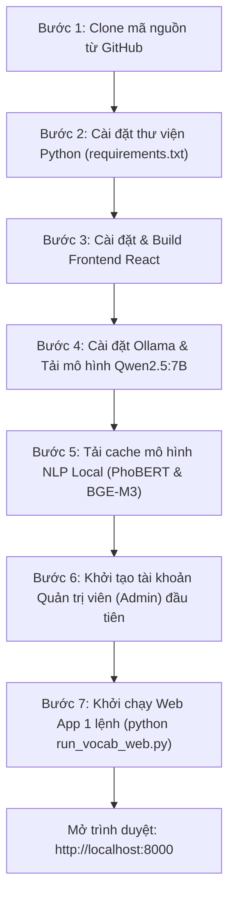

# HƯỚNG DẪN CÀI ĐẶT & THIẾT LẬP MÔI TRƯỜNG CHATBOX 2.0 TRÊN MÁY MỚI

Tài liệu này cung cấp hướng dẫn chi tiết từ A đến Z để thiết lập môi trường và khởi chạy thành công toàn bộ hệ thống **Chatbox 2.0 — Trợ Lý Tra Cứu Từ Vựng Tiếng Anh A1–B2** trên một máy tính hoàn toàn mới (Windows 10/11, macOS hoặc Ubuntu/Linux) thông qua Terminal / Dòng lệnh.

---

## 1. YÊU CẦU HỆ THỐNG (SYSTEM PREREQUISITES)

| Thành phần | Yêu cầu tối thiểu | Yêu cầu khuyến nghị | Ghi chú |
| :--- | :--- | :--- | :--- |
| **Hệ điều hành** | Windows 10/11, macOS 12+, Ubuntu 20.04+ | Windows 11 / Ubuntu 22.04 LTS | Tương thích đa nền tảng 100% |
| **Python** | **Python 3.10** hoặc **3.11** | **Python 3.11.x** | Tải từ [python.org](https://www.python.org/downloads/) |
| **Node.js & npm** | **Node.js v18+** | **Node.js v20 LTS** kèm npm | Tải từ [nodejs.org](https://nodejs.org/) (để build Frontend React) |
| **Git** | Bản mới nhất | Bản mới nhất | Tải từ [git-scm.com](https://git-scm.com/) |
| **Ollama** | Bản mới nhất | Bản mới nhất | Tải từ [ollama.com](https://ollama.com/) |
| **RAM** | Tối thiểu 8 GB | **16 GB trở lên** | Để chạy mô hình LLM và Embedding trong RAM |
| **Dung lượng ổ đĩa** | Tối thiểu 15 GB trống | SSD trống 25 GB+ | Lưu trữ trọng số mô hình Qwen, PhoBERT, BGE-M3 |
| **Card đồ họa (GPU)**| Không bắt buộc (Chạy CPU tự động) | **NVIDIA RTX / GTX (VRAM $\ge$ 4GB)** | Tăng tốc độ truy xuất Embedding và suy luận LLM |

> [!IMPORTANT]
> **Khi cài đặt Python trên Windows:**  
> Bắt buộc phải tích chọn ô **"Add Python to PATH"** ở màn hình cài đặt đầu tiên để có thể chạy lệnh `python` và `pip` trong mọi cửa sổ dòng lệnh.

> [!IMPORTANT]
> **Khi cài đặt Node.js trên Windows:**  
> Chọn cài đặt mặc định (Default Setup) để công cụ tự động thêm `node` và `npm` vào biến môi trường hệ thống. Sau khi cài, mở cửa sổ Terminal mới để kiểm tra: `node -v` và `npm -v`.

---

## 2. QUY TRÌNH CÀI ĐẶT TỪNG BƯỚC (STEP-BY-STEP SETUP)



---

### Bước 1: Tải mã nguồn về máy (Clone Repository)

Mở Terminal (PowerShell / Command Prompt trên Windows hoặc Bash trên macOS/Linux) và chạy:

```bash
git clone https://github.com/vmm2302/chatbox2.0.git
cd chatbox2.0
```

---

### Bước 2: Cài đặt các thư viện Python (Backend Dependencies)

> [!WARNING]
> **LƯU Ý QUAN TRỌNG VỀ PIP TRÊN WINDOWS:**  
> - **Tuyệt đối KHÔNG chạy lệnh `python -m pip install --upgrade pip`:** Trên hệ điều hành Windows, cơ chế khóa tệp (file locking) sẽ chặn tiến trình ghi đè, khiến thư mục pip bị đổi tên thành `~ip` và gây ra lỗi mất module pip (`No module named pip`).
> - Cài đặt trực tiếp danh sách thư viện từ file `requirements.txt`.

Cài đặt toàn bộ danh sách thư viện backend:

```bash
pip install -r requirements.txt
```
*(Hoặc `python -m pip install -r requirements.txt`)*

> [!TIP]
> **Kích hoạt tăng tốc GPU NVIDIA (Khuyên dùng nếu máy có card RTX / GTX):**  
> Mặc định pip sẽ cài bản PyTorch chạy trên CPU. Để tăng tốc độ trích xuất đặc trưng BGE-M3 gấp **15 – 20 lần** (từ 240+ từ/giây) và giải phóng CPU, hãy chạy thêm lệnh:
> ```bash
> pip install torch --index-url https://download.pytorch.org/whl/cu124
> ```
> Hệ thống sẽ tự động phát hiện GPU và chuyển toàn bộ tác vụ Embedding sang card NVIDIA.

---

### Bước 3: Cài đặt & Biên dịch Frontend Web React (Vite + Tailwind)

Mở Terminal tại thư mục dự án và thực hiện:

```bash
cd vocab_frontend
npm install
npm run build
cd ..
```

Lệnh trên sẽ:
1. Cài đặt các thư viện giao diện: React 18, Vite, Tailwind CSS, Lucide Icons, Canvas Confetti.
2. Biên dịch mã nguồn Frontend thành gói tĩnh siêu nhẹ đặt tại `vocab_frontend/dist`.
3. Backend FastAPI sẽ tự động phục vụ trực tiếp thư mục `dist` này.

---

### Bước 4: Cài đặt Ollama & Tải mô hình LLM Qwen2.5:7B

1. Tải và cài đặt Ollama từ [https://ollama.com](https://ollama.com).
2. Khởi động dịch vụ Ollama:
   - Trên Windows: Mở ứng dụng Ollama từ Start Menu (icon con lạc đà trên Taskbar).
   - Hoặc chạy trên Terminal:
     ```bash
     ollama serve
     ```
3. Mở một cửa sổ Terminal mới và tải mô hình ngôn ngữ:
   ```bash
   ollama pull qwen2.5:7b
   ```
   > [!NOTE]
   > Nếu máy tính có RAM dưới 8 GB hoặc không có GPU rời, bạn có thể tải bản gọn nhẹ hơn:
   > ```bash
   > ollama pull qwen2.5:3b
   > ```
   > Sau đó đặt biến môi trường trong file `.env`: `OLLAMA_MODEL=qwen2.5:3b`.

---

### Bước 5: Tải trước các mô hình NLP cục bộ (PhoBERT & BGE-M3)

Chạy script tải tự động trọng số mô hình vào cache máy tính để phục vụ chế độ chạy **100% Offline**:

```bash
python scripts/download_models.py
```

Script sẽ tải và lưu trữ vào Hugging Face local cache:
- **`vinai/phobert-base-v2`**: Nhận diện ý định câu hỏi tiếng Việt (Intent Classification).
- **`BAAI/bge-m3`**: Mã hóa ngữ nghĩa đa ngữ 1024 chiều (Dense Retrieval) cho ChromaDB.

---

### Bước 6: Khởi tạo tài khoản Quản trị viên (Admin) đầu tiên

Chạy script khởi tạo tài khoản quản trị hệ thống:

```bash
python scripts/create_admin.py
```

Nhập thông tin theo hướng dẫn trên màn hình:
- **Username**: Ví dụ `admin`
- **Tên hiển thị (Display Name)**: Ví dụ `Quản Trị Viên`
- **Mật khẩu**: Tối thiểu 8 ký tự, có chữ hoa, chữ thường và số (Mật khẩu được băm một chiều bằng Bcrypt an toàn).

---

### Bước 7: Khởi chạy ứng dụng Web (Chỉ 1 lệnh duy nhất)

Chạy lệnh khởi động ứng dụng web hiện đại:

```bash
python run_vocab_web.py
```

*(Hoặc trên Windows PowerShell: `.\run_vocab_web.ps1`)*

**Tính năng tự động thông minh của script:**
- Tự động kiểm tra và giải phóng cổng `8000` nếu có tiến trình cũ chiếm dụng.
- Khởi động backend FastAPI và nạp các mô hình AI trong nền.
- Cơ chế Smart Readiness: Tự động mở trình duyệt web tại địa chỉ **`http://localhost:8000`** ngay khi hệ thống và mô hình đã sẵn sàng 100%.

---

## 3. CÁC PHƯƠNG THỨC KHỞI CHẠY KHÁC (ALTERNATIVE INTERFACES)

Nếu bạn muốn chạy giao diện khác hoặc phát triển giao diện React với tính năng Hot-Reloading:

### 1. Chế độ Phát triển Frontend React (Hot Reload)
Nếu bạn muốn chỉnh sửa mã nguồn React và thấy thay đổi ngay lập tức:
```bash
# Terminal 1: Chạy backend FastAPI
python -m uvicorn vocab_backend.api_server:app --port 8000 --reload

# Terminal 2: Chạy Vite dev server
cd vocab_frontend
npm run dev
```
> Truy cập tại: **`http://localhost:5173`** (Vite sẽ tự động proxy các request `/api` sang cổng 8000).

### 2. Giao diện Streamlit (Giao diện truyền thống)
```bash
streamlit run src/ui/app.py --server.port 8501
```
> Truy cập tại: **`http://localhost:8501`**.

### 3. Giao diện Dòng lệnh (CLI)
```bash
python src/ui/cli.py
```

---

## 4. KIỂM THỬ TỰ ĐỘNG HỆ THỐNG (AUTOMATED VERIFICATION)

Để kiểm tra toàn diện hoạt động của tất cả các module trên máy tính mới:

```bash
# Kiểm thử toàn diện Auth, Admin, SSE Streaming, Chống trùng lặp tệp raw và Xóa tri thức:
python tests/test_vocab_auth_admin.py
```

Kết quả mong đợi:
```
ALL ADMIN & MULTI-FILE UPLOAD TESTS PASSED!
```

---

## 5. XỬ LÝ SỰ CỐ THƯỜNG GẶP (TROUBLESHOOTING)

### 1. Lỗi `No module named pip` hoặc thư mục `~ip` trên Windows
- **Nguyên nhân:** Chạy lệnh nâng cấp pip `python -m pip install --upgrade pip` bị khóa file trên Windows.
- **Cách khắc phục:** Chạy lệnh khôi phục pip tích hợp:
  ```bash
  python -m ensurepip --default-pip
  ```

### 2. Lỗi `ConnectionRefusedError: [WinError 10061]` khi gọi Ollama
- **Nguyên nhân:** Dịch vụ Ollama chưa được bật trên máy tính.
- **Cách khắc phục:** Mở ứng dụng Ollama từ Start Menu hoặc mở một cửa sổ Terminal và gõ:
  ```bash
  ollama serve
  ```

### 3. Lỗi `npm` hoặc `node` không được nhận diện (`command not found`)
- **Nguyên nhân:** Chưa cài Node.js hoặc chưa thêm Node.js vào biến môi trường PATH.
- **Cách khắc phục:** Tải và cài đặt Node.js LTS từ [nodejs.org](https://nodejs.org/), sau đó **tắt và mở lại cửa sổ Terminal** để hệ thống nhận PATH mới.

### 4. Lỗi cổng 8000 bị chiếm dụng (`Port 8000 is already in use`)
- Script `run_vocab_web.py` đã tích hợp sẵn tính năng tự động tìm và tắt tiến trình cũ chiếm cổng.
- Nếu muốn giải phóng thủ công trên Windows PowerShell:
  ```powershell
  Get-Process -Id (Get-NetTCPConnection -LocalPort 8000).OwningProcess | Stop-Process -Force
  ```

### 5. Máy tính cấu hình yếu / Không có card GPU rời
- Hệ thống được cấu hình tự động nhận diện phần cứng: nếu không có GPU NVIDIA, hệ thống sẽ tự động fallback về chạy trên CPU an toàn.
- Bạn có thể chuyển sang sử dụng mô hình nhẹ hơn của Ollama:
  ```bash
  ollama pull qwen2.5:3b
  ```
  Sau đó chỉnh sửa tham số `OLLAMA_MODEL` trong `config/settings.py` hoặc file `.env` thành `qwen2.5:3b`.
