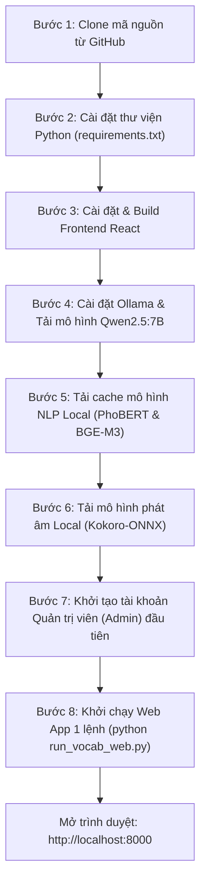

# HƯỚNG DẪN CÀI ĐẶT & THIẾT LẬP MÔI TRƯỜNG CHATBOX TRÊN MÁY MỚI

Tài liệu này cung cấp hướng dẫn chi tiết từ A đến Z để thiết lập môi trường và khởi chạy thành công toàn bộ hệ thống **Chatbot cho từ vựng A1 - A2** trên một máy tính hoàn toàn mới (Windows 10/11, macOS hoặc Ubuntu/Linux) thông qua Terminal / Dòng lệnh.

> **Lưu ý về dữ liệu:** Repository không phân phối corpus từ vựng, file nguồn hay manifest. Sau khi khởi chạy, hãy nạp qua trang quản trị một tệp mà bạn có quyền sử dụng. Các file raw/processed và chỉ mục được tạo sẽ chỉ nằm trên máy local.

---

## 1. YÊU CẦU HỆ THỐNG (SYSTEM PREREQUISITES)

| Thành phần | Yêu cầu tối thiểu | Yêu cầu khuyến nghị | Ghi chú |
| :--- | :--- | :--- | :--- |
| **Hệ điều hành** | Windows 10/11, macOS 12+, Ubuntu 20.04+ | Windows 11 / Ubuntu 22.04 LTS | Tương thích đa nền tảng 100% |
| **Python** | **Python 3.10** hoặc **3.11** | **Python 3.11.x** | Tải từ [python.org](https://www.python.org/downloads/) |
| **Node.js & npm** | **Node.js v18+** | **Node.js v20 LTS** kèm npm | Tải từ [nodejs.org](https://nodejs.org/) (để build Frontend React) |
| **Git** | Bản mới nhất | Bản mới nhất | Tải từ [git-scm.com](https://git-scm.com/) |
| **Ollama** | Bản mới nhất | Bản mới nhất | Tải từ [ollama.com](https://ollama.com/) |
| **RAM** | Tối thiểu 8 GB | **16 GB trở lên** | Để chạy mô hình LLM và Embedding trong RAM |
| **Dung lượng ổ đĩa** | Tối thiểu 15 GB trống | SSD trống 25 GB+ | Lưu trữ trọng số mô hình Qwen, PhoBERT, BGE-M3 |
| **Card đồ họa (GPU)**| Không bắt buộc (Chạy CPU tự động) | **NVIDIA RTX / GTX (VRAM $\ge$ 4GB)** | Tăng tốc độ truy xuất Embedding và suy luận LLM |

> [!IMPORTANT]
> **Khi cài đặt Python trên Windows:**  
> Bắt buộc phải tích chọn ô **"Add Python to PATH"** ở màn hình cài đặt đầu tiên để có thể chạy lệnh `python` và `pip` trong mọi cửa sổ dòng lệnh.

> [!IMPORTANT]
> **Khi cài đặt Node.js trên Windows:**  
> Chọn cài đặt mặc định (Default Setup) để công cụ tự động thêm `node` và `npm` vào biến môi trường hệ thống. Sau khi cài, mở cửa sổ Terminal mới để kiểm tra: `node -v` và `npm -v`.

---

## 2. QUY TRÌNH CÀI ĐẶT TỪNG BƯỚC (STEP-BY-STEP SETUP)



---

### Bước 1: Tải mã nguồn về máy (Clone Repository)

Mở Terminal (PowerShell / Command Prompt trên Windows hoặc Bash trên macOS/Linux) và chạy:

```bash
git clone https://github.com/vmm2302/chatbox2.0.git
cd chatbox2.0
```

---

### Bước 2: Cài đặt các thư viện Python (Backend Dependencies)

> [!WARNING]
> **LƯU Ý QUAN TRỌNG VỀ PIP TRÊN WINDOWS:**  
> - **Tuyệt đối KHÔNG chạy lệnh `python -m pip install --upgrade pip`:** Trên hệ điều hành Windows, cơ chế khóa tệp (file locking) sẽ chặn tiến trình ghi đè, khiến thư mục pip bị đổi tên thành `~ip` và gây ra lỗi mất module pip (`No module named pip`).
> - Cài đặt trực tiếp danh sách thư viện từ file `requirements.txt`.

Cài đặt môi trường ảo Python `.venv` (khuyên dùng) và toàn bộ thư viện backend:

```powershell
# Tạo & kích hoạt môi trường ảo trên Windows PowerShell
python -m venv .venv
.\.venv\Scripts\Activate.ps1

# Hoặc trên macOS / Linux:
# python3 -m venv .venv && source .venv/bin/activate

pip install -r requirements.txt
```
*(Hoặc `python -m pip install -r requirements.txt`)*

> [!TIP]
> **Kích hoạt tăng tốc GPU NVIDIA (Khuyên dùng nếu máy có card RTX / GTX):**  
> Mặc định pip sẽ cài bản PyTorch chạy trên CPU. Để tăng tốc độ trích xuất đặc trưng BGE-M3 gấp **15 – 20 lần** (từ 240+ từ/giây) và giải phóng CPU, hãy chạy thêm lệnh:
> ```bash
> pip install torch --index-url https://download.pytorch.org/whl/cu124
> ```
> Hệ thống sẽ tự động phát hiện GPU và chuyển toàn bộ tác vụ Embedding sang card NVIDIA.

---

### Bước 3: Cài đặt & Biên dịch Frontend Web React (Vite + Tailwind)

Mở Terminal tại thư mục dự án và thực hiện:

```bash
cd vocab_frontend
npm install
npm run build
cd ..
```

Lệnh trên sẽ:
1. Cài đặt các thư viện giao diện: React 19, Vite 8, Tailwind CSS v4, Lucide Icons, Canvas Confetti.
2. Biên dịch mã nguồn Frontend thành gói tĩnh siêu nhẹ đặt tại `vocab_frontend/dist`.
3. Backend FastAPI sẽ tự động phục vụ trực tiếp thư mục `dist` này.

---

### Bước 4: Cài đặt Ollama & Tải mô hình LLM Qwen2.5:7B

1. Tải và cài đặt Ollama từ [https://ollama.com](https://ollama.com).
2. Khởi động dịch vụ Ollama:
   - Trên Windows: Mở ứng dụng Ollama từ Start Menu (icon con lạc đà trên Taskbar).
   - Hoặc chạy trên Terminal:
     ```bash
     ollama serve
     ```
3. Mở một cửa sổ Terminal mới và tải mô hình ngôn ngữ:
   ```bash
   ollama pull qwen2.5:7b
   ```
   > [!NOTE]
   > Nếu máy tính có RAM dưới 8 GB hoặc không có GPU rời, bạn có thể tải bản gọn nhẹ hơn:
   > ```bash
   > ollama pull qwen2.5:3b
   > ```
   > Sau đó đặt biến môi trường trong file `.env`: `OLLAMA_MODEL=qwen2.5:3b`.

---

### Bước 5: Tải trước các mô hình NLP cục bộ (PhoBERT & BGE-M3)

Chạy script tải tự động trọng số mô hình vào cache máy tính để phục vụ chế độ chạy **100% Offline**:

```bash
python scripts/download_models.py
```

Script sẽ tải và lưu trữ vào Hugging Face local cache:
- **`vinai/phobert-base-v2`**: Nhận diện ý định câu hỏi tiếng Việt (Intent Classification).
- **`BAAI/bge-m3`**: Mã hóa ngữ nghĩa đa ngữ 1024 chiều (Dense Retrieval) cho ChromaDB.

---

### Bước 6: Tải mô hình phát âm Text-to-Speech cục bộ (Kokoro-ONNX)

Ứng dụng sử dụng engine TTS offline **Kokoro-ONNX** lượng tử hóa INT8 kết hợp giọng đọc chuẩn Mỹ `af_heart` chạy hoàn toàn trên CPU:

```bash
python scripts/setup_kokoro_model.py
```

Script sẽ tự động tải các tệp sau vào thư mục `data/models/kokoro/`:
- **`kokoro-v1.0.int8.onnx`** (~88 MB): Mô hình âm thanh ONNX lượng tử hóa INT8.
- **`voices-v1.0.bin`** (~27 MB): Bộ vector giọng đọc tiếng Anh (bao gồm giọng `af_heart`).

> [!NOTE]
> Hệ thống phát âm chạy **100% Offline** trên CPU máy tính người dùng mà không cần kết nối Internet, không phụ thuộc Web Speech API của trình duyệt hay bất kỳ dịch vụ đám mây bên ngoài nào.

---

### Bước 7: Khởi tạo tài khoản Quản trị viên (Admin) đầu tiên

Chạy script khởi tạo tài khoản quản trị hệ thống:

```bash
python scripts/create_admin.py
```

Nhập thông tin theo hướng dẫn trên màn hình:
- **Username**: Ví dụ `admin`
- **Tên hiển thị (Display Name)**: Ví dụ `Quản Trị Viên`
- **Mật khẩu**: Tối thiểu 8 ký tự, có chữ hoa, chữ thường và số (Mật khẩu được băm một chiều bằng Bcrypt an toàn).

---

### Bước 8: Khởi chạy ứng dụng Web (Chỉ 1 lệnh duy nhất)

Chạy lệnh khởi động ứng dụng web hiện đại:

```bash
python run_vocab_web.py
```

*(Hoặc trên Windows PowerShell: `.\run_vocab_web.ps1`)*

**Tính năng an toàn & tự động của script:**
- Kiểm tra tình trạng cổng mạng trước khi khởi động (mặc định `8000`). **Không dừng hay tắt bất kỳ tiến trình nào đang chạy**; nếu cổng bận, hệ thống thông báo và yêu cầu người dùng nhập cổng khác (hoặc truyền `--port 8001`).
- Khởi động backend FastAPI và nạp các mô hình AI trong nền.
- Cơ chế Smart Readiness: Tự động mở trình duyệt web tại địa chỉ **`http://localhost:<port>`** ngay khi hệ thống và mô hình đã sẵn sàng 100%.

---

## 3. CHẾ ĐỘ PHÁT TRIỂN FRONTEND REACT (HOT RELOAD)

### 1. Chế độ Phát triển Frontend React (Hot Reload)
Nếu bạn muốn chỉnh sửa mã nguồn React và thấy thay đổi ngay lập tức:
```bash
# Terminal 1: Chạy backend FastAPI
python -m uvicorn vocab_backend.api_server:app --port 8000 --reload

# Terminal 2: Chạy Vite dev server
cd vocab_frontend
npm run dev
```
> Truy cập tại: **`http://localhost:5173`** (Vite sẽ tự động proxy các request `/api` sang cổng 8000).

---

## 4. THIẾT LẬP MÔI TRƯỜNG KIỂM THỬ & CHẠY BỘ TEST (TEST ENVIRONMENT & VERIFICATION)

Hệ thống cung cấp bộ kiểm thử phân tầng toàn diện (Unit Test, Security & RBAC Test, Dynamic Rubric Evaluation Test, Pronunciation Evaluation Test và Frontend Verification) nhằm đảm bảo hệ thống vận hành 100% chính xác, ổn định và độc lập trên máy tính mới.

---

### 4.1. Chuẩn bị Môi trường ảo & Biến môi trường kiểm thử (Test Environment Setup)

Đảm bảo đã kích hoạt `.venv` và cài đủ thư viện trong `requirements.txt` (bao gồm `pyvi` cho bộ tách từ PhoBERT, `kokoro-onnx` & `soundfile` cho kiểm thử phát âm, và Node.js v18+ cho Frontend):

```powershell
# Windows PowerShell: kích hoạt .venv
.\.venv\Scripts\Activate.ps1
```

Trước khi chạy các bài kiểm thử, cấu hình các biến môi trường để ép buộc toàn bộ hệ thống hoạt động ở chế độ **100% Cục bộ (Offline-only)** và tùy chọn cố định seed hoặc DB kiểm thử:

**Trên Windows (PowerShell):**
```powershell
$env:TESTING="1"
$env:HF_HUB_OFFLINE="1"
$env:TRANSFORMERS_OFFLINE="1"
# Tùy chọn: tái lập bộ mẫu ngẫu nhiên cho test_chatbot_rubric.py
# $env:RUBRIC_TEST_SEED="42"
# Tùy chọn: khóa bí mật ký Access Token trong môi trường test
# $env:AUTH_TOKEN_SECRET="test-secret-key"
```

**Trên Linux / macOS (Bash / Zsh):**
```bash
export TESTING=1
export HF_HUB_OFFLINE=1
export TRANSFORMERS_OFFLINE=1
# export RUBRIC_TEST_SEED=42
```

> [!NOTE]
> Để thực hiện đầy đủ các ca test có bước sinh ngôn ngữ tự nhiên (`RAG_GENERATION`), hãy đảm bảo dịch vụ Ollama đang chạy ngầm (`ollama serve` với model `qwen2.5:7b`). Nếu Ollama tắt, các ca phụ thuộc `RAG_GENERATION` trong `test_chatbot_rubric.py` sẽ tự động được ghi nhận là `BLOCKED` / `skipped` (không đánh dấu PASS giả).

---

### 4.2. Chuẩn bị dữ liệu mẫu phục vụ kiểm thử (Test Data Preparation)

Nếu máy tính mới vừa được thiết lập và cơ sở tri thức chưa có dữ liệu, hãy tạo bộ dữ liệu kiểm thử tiêu chuẩn và nạp vào hệ thống bằng lệnh:

```bash
# 1. Tạo file dữ liệu mẫu chuẩn cấu trúc Excel A1 - B2
python scripts/create_sample_excel.py

# 2. Nạp dữ liệu vào cơ sở tri thức (ChromaDB + BM25 + JSONL)
python ingest_data.py
```

---

### 4.3. Bảng tổng hợp các lệnh kiểm thử phân hệ Backend

Bạn có thể chạy kiểm thử theo từng phân hệ nghiệp vụ cụ thể hoặc chạy toàn bộ test suite để nghiệm thu hệ thống:

| Phân hệ kiểm thử | Lệnh thực thi Terminal | Mục tiêu kiểm định | Kết quả mong đợi |
| :--- | :--- | :--- | :---: |
| **1. Access Token, Phân quyền, Khóa phiên, Port & Tách từ `pyvi`** | `python -m unittest tests/test_security_and_segmentation.py -v` | Kiểm chứng chữ ký/thu hồi Access Token, chống IDOR & giả mạo role, khóa phiên gắn user trên `/api/chat` & `/api/chat/stream`, cơ chế đổi cổng không kill tiến trình ở `run_vocab_web.py`, tách từ `pyvi` trong `phobert_intent.py`. | `OK` |
| **2. Vòng đời Tài khoản, RBAC & Cách ly SQLite** | `python -m unittest tests/test_auth_rbac_isolation.py -v` | Kiểm tra đăng ký, đăng nhập, bảo vệ Admin, cách ly dữ liệu hội thoại giữa các tài khoản trên DB tạm cô lập. | `OK` |
| **3. Quản trị & Tích hợp Auth/Admin API** | `python tests/test_vocab_auth_admin.py` | Kiểm tra luồng Đăng nhập, Đăng ký, Phân quyền Admin/User, Nạp nhiều file, Xóa nguồn tài liệu an toàn. | `ALL ADMIN & MULTI-FILE UPLOAD TESTS PASSED!` |
| **4. Đánh giá Động Chuẩn Rubric (Không ghi cứng)** | `python -m unittest tests/test_chatbot_rubric.py -v` | Lấy mẫu động trực tiếp từ KB thực tế cho 5 nhóm Rubric + kiểm tra từ ngoài KB không hallucinate; đối chiếu ground-truth nghĩa/IPA/ví dụ/cấp độ và tự động xuất báo cáo `docs/CHATBOT_TEST_REPORT.md`. | `OK` (hoặc `skipped` cho ca RAG nếu Ollama tắt) |
| **5. Động cơ Phát âm TTS Cục bộ (Kokoro-ONNX)** | `python -m unittest tests/test_kokoro_tts.py -v` | Kiểm tra khả năng nạp mô hình ONNX, bộ đệm LRU Cache âm thanh, chuẩn hóa dấu câu và sinh tệp WAV 24kHz. | `Ran 9 tests ... OK` |
| **6. Đánh giá Chất lượng Phát âm Âm học (Pronunciation Evaluation)** | `python -m unittest tests/test_pronunciation_evaluation.py -v` | Đo lường 24.000 Hz Mono 16-bit, năng lượng RMS chống câm/vỡ tiếng, tương quan thời lượng–âm tiết, ngữ âm phức tạp, RTF, tỷ lệ tốc độ đọc chậm, mẫu từ KB thực tế và API `/api/tts/synthesize`. | `Ran 8 tests ... OK` |
| **7. Tra cứu & Dịch Việt → Anh** | `python -m unittest tests/test_vietnamese_to_english.py -v` | Kiểm tra nhận diện ý định dịch Việt → Anh, từ ngoài phạm vi và luồng SSE streaming. | `OK` |
| **8. Luồng Tích hợp E2E Đa cấp độ** | `python tests/test_multi_level_e2e_flow.py` | Kiểm định trọn vẹn luồng nạp đa cấp độ và khám phá từ vựng động. | `ALL MULTI-LEVEL E2E INTEGRATION FLOW TESTS PASSED 100%!` |
| **9. Toàn bộ Test Suite Dự án** | `python -m unittest discover -s tests -p "test_*.py"` | Tự động quét và thực thi toàn bộ các tệp kiểm thử `unittest` của dự án. | `OK` |

---

### 4.4. Kiểm thử và Nghiệm thu Giao diện Frontend React (Vite UI Verification)

Để kiểm tra tính toàn vẹn cú pháp JSX, linter, đóng gói sản xuất và unit test dịch vụ Frontend:

```bash
cd vocab_frontend

# 1. Kiểm tra tĩnh cú pháp và chất lượng mã nguồn (Linter):
npm run lint

# 2. Kiểm thử quy trình đóng gói & biên dịch (Vite Bundler):
npm run build

# 3. Chạy trọn bộ nghiệm thu tự động (Build + Lint + Node unit tests):
npm test

cd ..
```

**Tiêu chí nghiệm thu Frontend ĐẠT (PASS):**
- Lệnh `npm run lint` đạt **0 warnings, 0 errors**.
- Lệnh `npm run build` hoàn thành với **0 lỗi**, tạo gói bundle tối ưu tại `vocab_frontend/dist/` (`index.html`, `assets/*.css`, `assets/*.js`).
- Các unit test dịch vụ (`node --test tests/*.test.mjs`) đạt **6/6 PASS** (vòng đời Access Token trong RAM, SSE parser, CEFR & Theme helpers).
- Chi tiết bảng kiểm thử chức năng người dùng được lưu trữ tại: `docs/BIEN_BAN_NGHIEM_THU_REACT.md`.

## 5. XỬ LÝ SỰ CỐ THƯỜNG GẶP (TROUBLESHOOTING)

### 1. Lỗi `No module named pip` hoặc thư mục `~ip` trên Windows
- **Nguyên nhân:** Chạy lệnh nâng cấp pip `python -m pip install --upgrade pip` bị khóa file trên Windows.
- **Cách khắc phục:** Chạy lệnh khôi phục pip tích hợp:
  ```bash
  python -m ensurepip --default-pip
  ```

### 2. Lỗi `ConnectionRefusedError: [WinError 10061]` khi gọi Ollama
- **Nguyên nhân:** Dịch vụ Ollama chưa được bật trên máy tính.
- **Cách khắc phục:** Mở ứng dụng Ollama từ Start Menu hoặc mở một cửa sổ Terminal và gõ:
  ```bash
  ollama serve
  ```

### 3. Lỗi `npm` hoặc `node` không được nhận diện (`command not found`)
- **Nguyên nhân:** Chưa cài Node.js hoặc chưa thêm Node.js vào biến môi trường PATH.
- **Cách khắc phục:** Tải và cài đặt Node.js LTS từ [nodejs.org](https://nodejs.org/), sau đó **tắt và mở lại cửa sổ Terminal** để hệ thống nhận PATH mới.

### 4. Lỗi cổng 8000 đang được sử dụng (`Cổng 8000 đang được tiến trình khác sử dụng`)
- Script `run_vocab_web.py` **không dừng hoặc tắt bất kỳ tiến trình nào đang chạy**, mà chỉ thông báo và yêu cầu bạn nhập một cổng khác (từ `1024` đến `65535`).
- Bạn cũng có thể truyền trực tiếp cổng khác ngay khi khởi chạy:
  ```bash
  python run_vocab_web.py --port 8001
  ```
  *(Hoặc trên PowerShell: `.\run_vocab_web.ps1 --port 8001`)*

### 5. Máy tính cấu hình yếu / Không có card GPU rời
- Hệ thống được cấu hình tự động nhận diện phần cứng: nếu không có GPU NVIDIA, hệ thống sẽ tự động fallback về chạy trên CPU an toàn.
- Bạn có thể chuyển sang sử dụng mô hình nhẹ hơn của Ollama:
  ```bash
  ollama pull qwen2.5:3b
  ```
  Sau đó chỉnh sửa tham số `OLLAMA_MODEL` trong `config/settings.py` hoặc file `.env` thành `qwen2.5:3b`.

### 6. Lỗi phát âm hoặc thông báo "Mô hình phát âm cục bộ (Kokoro-ONNX) chưa sẵn sàng"
- **Nguyên nhân:** Thiếu tệp mô hình `kokoro-v1.0.int8.onnx` hoặc `voices-v1.0.bin` trong thư mục `data/models/kokoro/`.
- **Cách khắc phục:** Chạy script tải mô hình TTS:
  ```bash
  python scripts/setup_kokoro_model.py
  ```
  Nếu chạy offline hoàn toàn trên máy cô lập không có Internet, chỉ cần chép nguyên thư mục `data/models/kokoro/` từ máy đã cài đặt sang.
