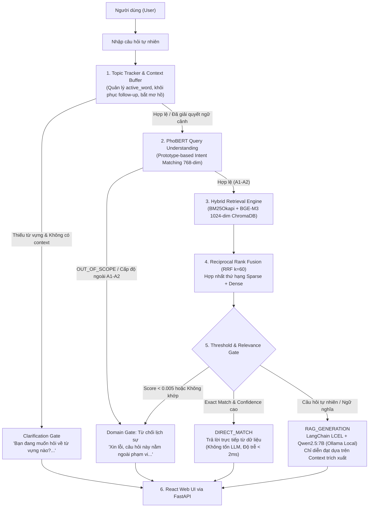

# CHATBOT CHO TỪ VỰNG A1 - A2
## MASTER ARCHITECTURE DOCUMENTATION & TECHNICAL REVIEW PACKAGE

> **Dự án Chatbot Tra cứu Từ vựng Tiếng Anh A1 - A2 bằng Ngôn ngữ Tự nhiên chạy 100% Cục bộ (Local-Only).**
> Ứng dụng giới hạn phạm vi kiến thức chuẩn CEFR A1 và A2, hỗ trợ kho tri thức do người triển khai cung cấp và nạp vào máy local. Các corpus nguồn và dữ liệu đã xử lý không được phân phối trong repository.

---

## 1. TỔNG QUAN KIẾN TRÚC HỆ THỐNG (SYSTEM ARCHITECTURE)

Hệ thống được thiết kế theo mô hình **Controlled Hybrid RAG Pipeline** với quy trình phân tách trách nhiệm chặt chẽ:



---

## 2. BẢNG MÔ TẢ CÁC THÀNH PHẦN KỸ THUẬT (CORE COMPONENTS)

| Thành phần | Công nghệ / Thuật toán | Vai trò & Đặc điểm kỹ thuật |
| :--- | :--- | :--- |
| **Topic Tracker** | Rule-based & Context Buffer | Quản lý `active_word`, phân giải đại từ (`"từ này"`, `"nó"`), kích hoạt hỏi lại (`CLARIFICATION`). |
| **Query Understanding** | `vinai/phobert-base-v2` | Phân loại ý định qua Prototype Centroids (Cosine Similarity 768 chiều), chặn truy vấn ngoài phạm vi hoặc ngoài A1–A2. |
| **Sparse Retrieval** | `rank-bm25` (BM25Okapi) | Bắt chính xác từ khóa, mã định danh, cấp độ CEFR A1/A2 và các thuật ngữ vựng học. |
| **Dense Retrieval** | `BAAI/bge-m3` + `ChromaDB` | Truy xuất tương đồng ngữ nghĩa đa ngữ 1024 chiều, lưu trữ persistent trên đĩa cục bộ (chỉ chứa vector A1/A2). |
| **Thứ hạng kết hợp** | Reciprocal Rank Fusion ($k=60$) | $RRF(d) = \frac{1}{60 + r_{bm25}} + \frac{1}{60 + r_{bge}}$, cân bằng tối ưu giữa từ khóa và ngữ nghĩa. |
| **Language Model** | `Qwen2.5:7B` via Ollama | Chạy trên GPU NVIDIA RTX 3050 (~4.8 GB VRAM), nhiệt độ $T=0.0$, lọc sạch ký tự chữ Hán. |
| **Framework RAG** | LangChain Core & LCEL | `ChatPromptTemplate | ChatOllama | StrOutputParser` với Strict Grounding System Prompt. |
| **Phát âm Text-to-Speech** | `Kokoro-ONNX` (int8, af_heart) | Phát âm giọng Mỹ chuẩn tự nhiên 100% offline trên CPU, không phụ thuộc Web Speech API hay Cloud. |
| **Giao diện người dùng** | React + Vite, FastAPI | Chatbot web tương tác cho từ vựng A1–A2, streaming qua SSE, phát âm chuẩn audio bản ngữ. |

---

## 3. CẤU TRÚC THƯ MỤC DỰ ÁN (PROJECT DIRECTORY STRUCTURE)

```text
chatbox2.0/
├── config/                      # Cấu hình đường dẫn, siêu tham số RRF, Ollama model, settings
├── data/
│   ├── app_data.db              # SQLite quản lý người dùng, phiên và lịch sử hội thoại
│   ├── models/                  # Thư mục lưu trữ mô hình offline (Kokoro TTS ONNX & Voices)
│   ├── raw/                     # Tệp nguồn do người dùng cung cấp (.xlsx, .xls, .csv, .pdf)
│   └── processed/               # Q&A (chỉ A1–A2) và manifest được tạo local
├── vocab_backend/               # Web Backend FastAPI: Streaming SSE, REST API, Auth, Admin, TTS
├── vocab_frontend/              # Web Frontend React + Vite + Tailwind CSS (Chatbot cho từ vựng A1 - A2)
├── run_vocab_web.py             # Script 1-Click khởi chạy thống nhất Backend & Frontend (Cổng 8000)
├── run_vocab_web.ps1            # PowerShell script khởi chạy siêu tốc trên Windows
├── assets/                      # Ảnh đại diện bot/user, flowchart kiến trúc RAG
├── docs/                        # Báo cáo kỹ thuật, Rubric review, giấy phép Kokoro TTS
├── scripts/
│   ├── create_admin.py          # Khởi tạo Quản trị viên (Admin) đầu tiên an toàn qua CLI
│   ├── setup_kokoro_model.py    # Tải và đóng gói mô hình phát âm Kokoro TTS (100% offline)
│   └── download_models.py       # Tải trước PhoBERT-base-v2 và BGE-M3 vào local cache
├── src/
│   ├── auth/                    # Module xác thực & phân quyền (Bcrypt, Session, RBAC)
│   ├── chat/                    # Topic Tracker & Engine điều phối pipeline RAG
│   ├── core/                    # DTO Models & Exceptions
│   ├── data/                    # Quản lý dữ liệu ứng dụng & nạp Knowledge Base (Excel, CSV, PDF)
│   ├── llm/                     # LangChain LCEL & Ollama Client
│   ├── nlp/                     # PhoBERT Query Understanding & Intent Classifier
│   └── retriever/               # BGE-M3 ChromaDB + BM25Okapi + RRF Fusion (k=60)
├── tests/                       # Toàn bộ bài kiểm thử tự động (Unit, Integration & E2E Tests)
├── HUONG_DAN_CAI_DAT_MAY_MOI.md # Cẩm nang chi tiết thiết lập môi trường máy mới từ A-Z
├── requirements.txt             # Danh sách thư viện Python bắt buộc
└── README.md                    # Tài liệu kỹ thuật dự án
```

---

## 4. HƯỚNG DẪN CÀI ĐẶT & CHẠY DỰ ÁN TRÊN MÁY MỚI (QUICK START)

> 📘 **Xem cẩm nang hướng dẫn từng bước đầy đủ nhất tại:** [HUONG_DAN_CAI_DAT_MAY_MOI.md](HUONG_DAN_CAI_DAT_MAY_MOI.md)

> **Dữ liệu:** Repository không chứa bộ từ vựng hay corpus Q&A. Sau khi khởi chạy, hãy nạp một tệp nguồn mà bạn có quyền sử dụng qua trang quản trị hoặc CLI (`python ingest_data.py --file PATH_TO_YOUR_FILE --mode append`). Các tệp raw và processed sẽ được giữ local và bỏ qua bởi Git. Chỉ các từ vựng trình độ A1–A2 được đưa vào kho tri thức.

### Bước 1: Cài đặt thư viện Python & Frontend React

```bash
# 1. Cài đặt toàn bộ thư viện Python bắt buộc:
pip install -r requirements.txt

# (Khuyên dùng cho máy có GPU NVIDIA) Tăng tốc độ nạp dữ liệu gấp 15-20x:
pip install torch --index-url https://download.pytorch.org/whl/cu124

# 2. Cài đặt và build giao diện React:
cd vocab_frontend
npm install
npm run build
cd ..
```

### Bước 2: Tải mô hình cục bộ & Cấu hình (100% Offline)

```bash
# 1. Khởi động Ollama và tải mô hình Qwen2.5:7B:
ollama pull qwen2.5:7b

# 2. Tải trước mô hình PhoBERT-base-v2 và BGE-M3 vào local cache:
python scripts/download_models.py

# 3. Khởi tạo tài khoản Quản trị viên (Admin) đầu tiên:
python scripts/create_admin.py
```

### Bước 3: Khởi chạy ứng dụng Web (Chỉ 1 lệnh duy nhất)

```bash
python run_vocab_web.py
```

*(Hoặc trên Windows PowerShell: `.\run_vocab_web.ps1`)*

> 🌐 **Hệ thống sẽ tự động khởi động máy chủ và mở trình duyệt tại: `http://localhost:8000`**  
> - Giao diện tra cứu từ vựng hiện đại: **Chatbot cho từ vựng A1 - A2**.
> - Streaming SSE trực tiếp câu trả lời, phiên âm IPA, nghe phát âm audio chuẩn, thẻ từ vựng tương tác.
> - Cổng Quản trị hệ thống (VocabAdmin Portal) độc lập toàn màn hình.

- **Đăng nhập & Sử dụng:**
  - Khách chưa có tài khoản có thể chuyển sang tab **"📝 Đăng ký tài khoản"** để tự tạo tài khoản Người dùng (`user`).
  - Đăng nhập bằng tài khoản Quản trị viên (`admin`) đã tạo ở Bước 2 để truy cập toàn quyền Admin Dashboard, Quản lý tài khoản, Nạp Knowledge Base và Chẩn đoán hệ thống.

---

### Bước 4: Chạy kiểm thử tự động (Test Suite)

1. **Chạy bộ kiểm thử E2E Web Backend & Chatbot A1–A2:**
   ```bash
   python tests/test_vocab_web_e2e.py
   ```

2. **Chạy bộ kiểm thử Batch Ingestion đa định dạng A1–A2:**
   ```bash
   python -m unittest tests/test_batch_ingestion.py
   ```

3. **Chạy bộ kiểm thử Xóa dữ liệu Knowledge Base an toàn (14 kịch bản):**
   ```bash
   python -m unittest tests/test_clear_knowledge_base.py
   ```

4. **Chạy bộ kiểm thử chuẩn hóa không cần thư viện ngoài:**
   ```bash
   python -m unittest tests/test_all_unittest.py
   ```

---

## 5. HỆ THỐNG XÁC THỰC, PHÂN QUYỀN RBAC & QUẢN TRỊ DỮ LIỆU CÁ NHÂN

Hệ thống tài khoản và phân quyền của Chatbot cho từ vựng A1 - A2 được phát triển theo các chuẩn mực bảo mật cao nhất dành cho ứng dụng cục bộ:

### 5.1. Mô hình Phân quyền RBAC (Role-Based Access Control)

| Vai trò | Quyền hạn được phép | Giới hạn & Ngăn cấm |
| :--- | :--- | :--- |
| **User (Người dùng)** | • Đăng nhập / Đăng xuất.<br/>• Tra cứu từ vựng tiếng Anh A1–A2 bằng tiếng Việt.<br/>• Lưu lịch sử cuộc trò chuyện riêng.<br/>• Tạo mới, đổi tên hoặc xóa hội thoại của mình.<br/>• Xóa toàn bộ lịch sử trò chuyện của chính mình.<br/>• Cập nhật tên hiển thị và đổi mật khẩu cá nhân. | • Không xem hoặc truy cập Admin Dashboard.<br/>• Không xem tài khoản hoặc lịch sử người khác.<br/>• Không thể nạp, xóa hoặc chỉnh sửa Knowledge Base.<br/>• Không xem cấu hình phần cứng / telemetry.<br/>• Tuyệt đối không thể tự nâng quyền lên Admin. |
| **Admin (Quản trị viên)** | • Toàn bộ quyền của User.<br/>• Bảng điều khiển quản trị (Admin Dashboard) với tổng quan thống kê.<br/>• Tìm kiếm, lọc và xem danh sách tài khoản hệ thống.<br/>• Tạo tài khoản User hoặc Admin mới.<br/>• Vô hiệu hóa hoặc kích hoạt lại tài khoản người dùng.<br/>• Đặt lại mật khẩu cho người dùng.<br/>• Quản trị nạp tài liệu và xóa Knowledge Base (Add / Replace).<br/>• Xem chẩn đoán tài nguyên động (GPU, VRAM, RAM, Threads, Ollama).<br/>• Xem và tải về Nhật ký Kiểm toán Quản trị (Admin Audit Logs). | • Không thể tự xóa tài khoản quản trị đang đăng nhập.<br/>• Không thể vô hiệu hóa, giáng quyền hoặc xóa Quản trị viên cuối cùng của hệ thống.<br/>• Mặc định tôn trọng quyền riêng tư: Không hiển thị nội dung chat cá nhân của User trên Dashboard. |

### 5.2. Kiến trúc Cách ly Dữ liệu (Data Isolation) & Lưu trữ Riêng biệt

- **Cơ sở dữ liệu ứng dụng riêng biệt (`data/app_data.db`):**
  - Quản lý 4 bảng: `users`, `conversations`, `messages`, `audit_logs`.
  - Bật chế độ `WAL` (Write-Ahead Logging) và ràng buộc khóa ngoại `PRAGMA foreign_keys = ON;`.
  - Không bao giờ bị xóa khi xóa Knowledge Base.
- **Bảo vệ quyền sở hữu ở tầng Backend:**
  - Mọi thao tác đọc, ghi, cập nhật hoặc xóa cuộc hội thoại và tin nhắn đều bắt buộc phải kèm điều kiện `WHERE id = ? AND user_id = ?`. Người dùng không thể truy cập hội thoại của người khác chỉ bằng cách thay đổi mã `conversation_id`.
  - Khi Admin vô hiệu hóa một tài khoản, mọi lượt truy vấn hoặc thao tác tiếp theo từ tài khoản đó đều bị chặn tức thì ở backend.
- **Cách ly ngữ cảnh TopicTracker:**
  - Bộ đệm ngữ cảnh `TopicTracker` được khởi tạo độc lập theo phiên người dùng.
  - Khi người dùng đăng xuất, chuyển cuộc hội thoại hoặc chuyển tài khoản, hàm `tracker.clear()` được gọi để dọn sạch `active_word` và lịch sử ngữ cảnh, loại trừ 100% rủi ro rò rỉ ngữ cảnh giữa các người dùng.

---

## 6. CAM KẾT TUÂN THỦ (COMPLIANCE & INTEGRITY)

1. **100% Local Execution:** Toàn bộ quá trình suy luận của LLM (`Qwen2.5:7B`), Embeddings (`BGE-M3`), NLU (`PhoBERT-base-v2`) và Vector Search (`ChromaDB`) đều thực thi tại máy cục bộ của người dùng.
2. **Zero External API:** Không kết nối đến OpenAI, Anthropic, Gemini, HuggingFace Hub trong quá trình vận hành bình thường (`HF_HUB_OFFLINE=1`).
3. **No Hallucination:** Qwen2.5:7B chỉ được phép tổng hợp thông tin từ ngữ cảnh trích xuất. Khi kho tri thức local không có thông tin phù hợp hoặc câu hỏi yêu cầu cấp độ ngoài A1–A2, hệ thống từ chối thay vì suy đoán tự do.
4. **Transparent Provenance:** Mọi câu trả lời trên giao diện đều có Provenance Inspector đi kèm, cho phép người dùng kiểm tra tức thì Record ID, nguồn tệp, điểm BM25, điểm BGE-M3 và thứ hạng RRF.

---

## 7. HƯỚNG DẪN NẠP VÀ CẬP NHẬT DỮ LIỆU TỪ EXCEL (RAG INGESTION)

Hệ thống cho phép bạn đưa thêm từ vựng mới hoặc thay thế toàn bộ từ điển bằng tệp Excel (`.xlsx`, `.xls`) mà không cần fine-tune trọng số LLM:

### 7.1. Cấu trúc tệp Excel hỗ trợ
- **Kiểu 1 (Tự do):** Tệp Excel 1 sheet có các cột: `Câu hỏi` (bắt buộc), `Câu trả lời` (bắt buộc), `Từ vựng` (tùy chọn), `Trình độ` (bắt buộc A1 hoặc A2), `Nguồn` (tùy chọn).
- **Kiểu 2 (Mặc định đồ án):** Tệp có các sheet phân cấp trình độ; hệ thống tự động lọc chỉ nạp các bản ghi thuộc trình độ A1 và A2.

### 7.2. Hai cách cập nhật dữ liệu:
1. **Qua giao diện Web:**
   - Khởi chạy `python run_vocab_web.py`, đăng nhập với tài khoản Admin và mở mục nạp dữ liệu.
   - Tải tệp lên, chọn chế độ **Bổ sung từ mới (Merge)** rồi bắt đầu nạp.
2. **Qua công cụ dòng lệnh (CLI Ingestion):**
   - Chạy lệnh trực tiếp từ Terminal:
     ```bash
     python ingest_data.py --file "data/raw/my_vocabulary.xlsx" --mode append
     ```
- Chi tiết xem tại tài liệu: `docs/huong_dan_nap_du_lieu_excel.md`.

---

## 8. ADMIN BATCH MULTI-FILE UPLOAD & KNOWLEDGE BASE MANAGEMENT

Hệ thống trang bị tính năng **Quản trị Kho tri thức Nâng cao (Batch Multi-File Ingestion)** dành cho Admin:

### 8.1. Khả năng hỗ trợ định dạng
Hệ thống cho phép tải lên đồng thời nhiều tệp thuộc các định dạng:
- **Bảng tính & Dữ liệu bảng:** Excel (`.xlsx`, `.xls`), CSV (`.csv`).
- **Tài liệu văn bản:** PDF (`.pdf`).
- **Giới hạn trình độ A1–A2:** Hệ thống tự động lọc và chỉ nạp các bản ghi thuộc trình độ **A1** hoặc **A2**. Các dòng thuộc cấp độ B1 trở lên hoặc không xác định sẽ tự động bị bỏ qua và ghi nhận vào chỉ số `out_of_scope_skipped` trong báo cáo nạp tệp.

### 8.2. Đặc tính kỹ thuật cốt lõi
1. **File Processing Independence (Xử lý độc lập):** Mỗi tệp trong batch được phân tích và nạp độc lập. Tệp lỗi (hỏng cấu trúc, encoding sai) sẽ bị đánh dấu `FAILED` mà không làm rollback hay gián đoạn các tệp hợp lệ (`PARTIAL_SUCCESS`).
2. **Deduplication nghiêm ngặt:**
   - **File Hash (SHA-256):** Tự động phát hiện và bỏ qua các tệp đã từng được nạp (`SKIPPED`).
   - **Content Hash / Signature:** Khử trùng lặp từng cặp Q&A giữa các tệp trong cùng một batch.
3. **Quản lý Nguồn (Source Management):**
   - **Xóa Nguồn (Delete Source):** Xóa sạch vector khỏi ChromaDB, loại bỏ bản ghi trong JSONL và lập lại chỉ mục BM25 trong 1 click.
4. **Báo cáo tổng kết (Batch Ingestion Report):** Bảng tổng hợp chi tiết tỉ lệ thành công, số bản ghi trích xuất, số bản ghi A1/A2 thêm mới, số bản ghi ngoài phạm vi bị bỏ qua (`out_of_scope_skipped`) và số bản ghi trùng lặp.
