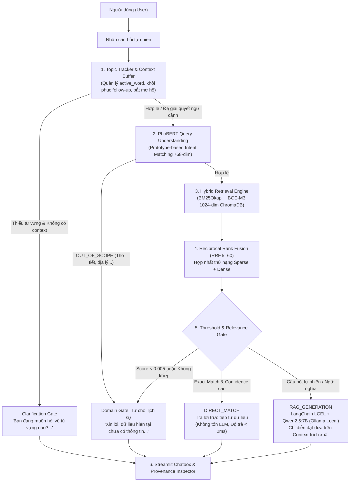

# CHATBOX 2.0 — LOCAL ENGLISH VOCABULARY CHATBOT
## MASTER ARCHITECTURE DOCUMENTATION & TECHNICAL REVIEW PACKAGE

> **Dự án Chatbot Tra cứu Từ vựng Tiếng Anh bằng Ngôn ngữ Tự nhiên chạy 100% Cục bộ (Local-Only).**  
> Tuân thủ nghiêm ngặt **Project Constraints**: Không dùng API bên ngoài, không Cloud LLM, không hallucination, hoạt động hoàn toàn offline với **Qwen2.5:7B (Ollama)**, **PhoBERT-base-v2 (VinAI)**, **BGE-M3 (BAAI)**, **BM25Okapi**, **ChromaDB Local**, và tập tri thức gồm **3,725 cặp Q&A**.

---

## 1. TỔNG QUAN KIẾN TRÚC HỆ THỐNG (SYSTEM ARCHITECTURE)

Hệ thống được thiết kế theo mô hình **Controlled Hybrid RAG Pipeline** với quy trình phân tách trách nhiệm chặt chẽ:



---

## 2. BẢNG MÔ TẢ CÁC THÀNH PHẦN KỸ THUẬT (CORE COMPONENTS)

| Thành phần | Công nghệ / Thuật toán | Vai trò & Đặc điểm kỹ thuật |
| :--- | :--- | :--- |
| **Topic Tracker** | Rule-based & Context Buffer | Quản lý `active_word`, phân giải đại từ (`"từ này"`, `"nó"`), kích hoạt hỏi lại (`CLARIFICATION`). |
| **Query Understanding** | `vinai/phobert-base-v2` | Phân loại ý định qua Prototype Centroids (Cosine Similarity 768 chiều), không train giả lập. |
| **Sparse Retrieval** | `rank-bm25` (BM25Okapi) | Bắt chính xác từ khóa, mã định danh, cấp độ CEFR và các thuật ngữ vựng học. |
| **Dense Retrieval** | `BAAI/bge-m3` + `ChromaDB` | Truy xuất tương đồng ngữ nghĩa đa ngữ 1024 chiều, lưu trữ persistent trên đĩa cục bộ. |
| **Thứ hạng kết hợp** | Reciprocal Rank Fusion ($k=60$) | $RRF(d) = \frac{1}{60 + r_{bm25}} + \frac{1}{60 + r_{bge}}$, cân bằng tối ưu giữa từ khóa và ngữ nghĩa. |
| **Language Model** | `Qwen2.5:7B` via Ollama | Chạy trên GPU NVIDIA RTX 3050 (~4.8 GB VRAM), nhiệt độ $T=0.0$, lọc sạch ký tự chữ Hán. |
| **Framework RAG** | LangChain Core & LCEL | `ChatPromptTemplate | ChatOllama | StrOutputParser` với Strict Grounding System Prompt. |
| **Giao diện người dùng** | Streamlit | Chatbox tương tác thời gian thực, tích hợp Provenance Inspector hiển thị toàn bộ chỉ số audit. |

---

## 3. CẤU TRÚC THƯ MỤC DỰ ÁN (PROJECT DIRECTORY STRUCTURE)

```text
chatbox2.0/
├── config/                      # Cấu hình đường dẫn, siêu tham số RRF, Ollama model, settings
├── data/
│   ├── raw/                     # Tài liệu nguồn: Oxford 3000 PDF, Excel, dictionary_en_vi.db (SQLite)
│   └── processed/               # qa_records.jsonl (8,300+ cặp Q&A) & sources_manifest.json
├── vocab_backend/               # Web Backend FastAPI: Streaming SSE, REST API, Auth, Admin, Sổ tay
├── vocab_frontend/              # Web Frontend React + Vite + Tailwind CSS (Chuẩn ChatGPT/Gemini)
├── run_vocab_web.py             # Script 1-Click khởi chạy thống nhất Backend & Frontend (Cổng 8000)
├── run_vocab_web.ps1            # PowerShell script khởi chạy siêu tốc trên Windows
├── assets/                      # Ảnh đại diện bot/user, flowchart kiến trúc RAG
├── docs/                        # Báo cáo kỹ thuật, Rubric review, hướng dẫn nghiệp vụ
├── scripts/
│   ├── create_admin.py          # Khởi tạo Quản trị viên (Admin) đầu tiên an toàn qua CLI
│   ├── download_models.py       # Tải trước PhoBERT-base-v2 và BGE-M3 vào local cache
│   └── sync_oxford_knowledge.py # Đồng bộ từ vựng Oxford 3000 và tra cứu SQLite
├── src/
│   ├── auth/                    # Module xác thực & phân quyền (Bcrypt, Session, RBAC)
│   ├── chat/                    # Topic Tracker & Engine điều phối pipeline RAG
│   ├── core/                    # DTO Models & Exceptions
│   ├── data/                    # Quản lý dữ liệu ứng dụng & nạp Knowledge Base
│   ├── llm/                     # LangChain LCEL & Ollama Client
│   ├── nlp/                     # PhoBERT Query Understanding & Intent Classifier
│   ├── retriever/               # BGE-M3 ChromaDB + BM25Okapi + RRF Fusion (k=60)
│   └── ui/                      # Giao diện Streamlit & Gradio truyền thống
├── tests/                       # Toàn bộ bài kiểm thử tự động (Unit, Integration & E2E Tests)
├── HUONG_DAN_CAI_DAT_MAY_MOI.md # Cẩm nang chi tiết thiết lập môi trường máy mới từ A-Z
├── requirements.txt             # Danh sách thư viện Python bắt buộc
└── README.md                    # Tài liệu kỹ thuật dự án
```

---

## 4. HƯỚNG DẪN CÀI ĐẶT & CHẠY DỰ ÁN TRÊN MÁY MỚI (QUICK START)

> 📘 **Xem cẩm nang hướng dẫn từng bước đầy đủ nhất tại:** [HUONG_DAN_CAI_DAT_MAY_MOI.md](HUONG_DAN_CAI_DAT_MAY_MOI.md)

### Bước 1: Cài đặt thư viện Python & Frontend React

```bash
# 1. Cài đặt toàn bộ thư viện Python bắt buộc:
pip install -r requirements.txt

# (Khuyên dùng cho máy có GPU NVIDIA) Tăng tốc độ nạp dữ liệu gấp 15-20x:
pip install torch --index-url https://download.pytorch.org/whl/cu124

# 2. Cài đặt và build giao diện React:
cd vocab_frontend
npm install
npm run build
cd ..
```

### Bước 2: Tải mô hình cục bộ & Cấu hình (100% Offline)

```bash
# 1. Khởi động Ollama và tải mô hình Qwen2.5:7B:
ollama pull qwen2.5:7b

# 2. Tải trước mô hình PhoBERT-base-v2 và BGE-M3 vào local cache:
python scripts/download_models.py

# 3. Khởi tạo tài khoản Quản trị viên (Admin) đầu tiên:
python scripts/create_admin.py
```

### Bước 3: Khởi chạy ứng dụng Web (Chỉ 1 lệnh duy nhất)

```bash
python run_vocab_web.py
```

*(Hoặc trên Windows PowerShell: `.\run_vocab_web.ps1`)*

> 🌐 **Hệ thống sẽ tự động khởi động máy chủ và mở trình duyệt tại: `http://localhost:8000`**  
> - Giao diện tra cứu từ vựng hiện đại, tối giản theo chuẩn ChatGPT/Gemini.
> - Streaming SSE trực tiếp câu trả lời, phiên âm IPA, phát âm audio chuẩn, thẻ từ vựng tương tác.
> - Sổ tay từ vựng & Flashcards lật thẻ thông minh.
> - Cổng Quản trị hệ thống (VocabAdmin Portal) độc lập toàn màn hình.

*(Tùy chọn khác: Chạy giao diện Streamlit qua lệnh `streamlit run src/ui/app.py --server.port 8501`)*

- **Đăng nhập & Sử dụng:**
  - Khách chưa có tài khoản có thể chuyển sang tab **"📝 Đăng ký tài khoản"** để tự tạo tài khoản Người dùng (`user`).
  - Đăng nhập bằng tài khoản Quản trị viên (`admin`) đã tạo ở Bước 2 để truy cập toàn quyền Admin Dashboard, Quản lý tài khoản, Nạp Knowledge Base và Chẩn đoán hệ thống.

- **Khởi chạy giao diện Gradio:**
  ```bash
  python src/ui/gradio_app.py
  ```
  *(Truy cập: `http://localhost:7860`)*

- **Khởi chạy giao diện Dòng lệnh (CLI):**
  ```bash
  python src/ui/cli.py
  ```

---

### Bước 4: Chạy kiểm thử tự động (Test Suite)

1. **Chạy bộ kiểm thử Xác thực, Phân quyền RBAC & Cách ly Dữ liệu (Mới):**
   ```bash
   python -m unittest tests.test_auth_rbac_isolation
   ```
   *(Kiểm tra 20 ca kiểm thử bảo mật: băm mật khẩu Bcrypt, đăng ký, đăng nhập, khóa tài khoản, bảo vệ Admin cuối cùng, cách ly cuộc trò chuyện và TopicTracker qua database SQLite tạm thời).*

2. **Chạy bộ 15 ca kiểm thử chuẩn hóa theo Rubric đồ án:**
   ```bash
   python -m unittest tests.test_chatbot_rubric
   ```
   *(Tự động chạy và cập nhật báo cáo chi tiết tại `docs/CHATBOT_TEST_REPORT.md`)*

3. **Chạy bộ kiểm thử chuẩn hóa không cần thư viện ngoài:**
   ```bash
   python -m unittest tests.test_all_unittest
   ```

---

## 5. HỆ THỐNG XÁC THỰC, PHÂN QUYỀN RBAC & QUẢN TRỊ DỮ LIỆU CÁ NHÂN

Hệ thống tài khoản và phân quyền của Chatbox 2.0 được phát triển theo các chuẩn mực bảo mật cao nhất dành cho ứng dụng cục bộ:

### 5.1. Mô hình Phân quyền RBAC (Role-Based Access Control)

| Vai trò | Quyền hạn được phép | Giới hạn & Ngăn cấm |
| :--- | :--- | :--- |
| **User (Người dùng)** | • Đăng nhập / Đăng xuất.<br/>• Tra cứu từ vựng tiếng Anh bằng tiếng Việt.<br/>• Lưu lịch sử cuộc trò chuyện riêng.<br/>• Tạo mới, đổi tên hoặc xóa hội thoại của mình.<br/>• Xóa toàn bộ lịch sử trò chuyện của chính mình.<br/>• Cập nhật tên hiển thị và đổi mật khẩu cá nhân. | • Không xem hoặc truy cập Admin Dashboard.<br/>• Không xem tài khoản hoặc lịch sử người khác.<br/>• Không thể nạp, xóa hoặc chỉnh sửa Knowledge Base.<br/>• Không xem cấu hình phần cứng / telemetry.<br/>• Tuyệt đối không thể tự nâng quyền lên Admin. |
| **Admin (Quản trị viên)** | • Toàn bộ quyền của User.<br/>• Bảng điều khiển quản trị (Admin Dashboard) với tổng quan thống kê.<br/>• Tìm kiếm, lọc và xem danh sách tài khoản hệ thống.<br/>• Tạo tài khoản User hoặc Admin mới.<br/>• Vô hiệu hóa hoặc kích hoạt lại tài khoản người dùng.<br/>• Đặt lại mật khẩu cho người dùng.<br/>• Quản trị nạp tài liệu và xóa Knowledge Base (Add / Replace).<br/>• Xem chẩn đoán tài nguyên động (GPU, VRAM, RAM, Threads, Ollama).<br/>• Xem và tải về Nhật ký Kiểm toán Quản trị (Admin Audit Logs). | • Không thể tự xóa tài khoản quản trị đang đăng nhập.<br/>• Không thể vô hiệu hóa, giáng quyền hoặc xóa Quản trị viên cuối cùng của hệ thống.<br/>• Mặc định tôn trọng quyền riêng tư: Không hiển thị nội dung chat cá nhân của User trên Dashboard. |

### 5.2. Kiến trúc Cách ly Dữ liệu (Data Isolation) & Lưu trữ Riêng biệt

- **Cơ sở dữ liệu ứng dụng riêng biệt (`data/app_data.db`):**
  - Quản lý 4 bảng: `users`, `conversations`, `messages`, `audit_logs`.
  - Bật chế độ `WAL` (Write-Ahead Logging) và ràng buộc khóa ngoại `PRAGMA foreign_keys = ON;`.
  - **Tuyệt đối không xâm phạm:** Cơ sở dữ liệu từ điển (`data/raw/dictionary_en_vi.db`), tệp `qa_records.jsonl`, và ChromaDB (`chroma_db/`) được giữ nguyên vẹn 100%.
- **Bảo vệ quyền sở hữu ở tầng Backend:**
  - Mọi thao tác đọc, ghi, cập nhật hoặc xóa cuộc hội thoại và tin nhắn đều bắt buộc phải kèm điều kiện `WHERE id = ? AND user_id = ?`. Người dùng không thể truy cập hội thoại của người khác chỉ bằng cách thay đổi mã `conversation_id`.
  - Khi Admin vô hiệu hóa một tài khoản, mọi lượt truy vấn hoặc thao tác tiếp theo từ tài khoản đó đều bị chặn tức thì ở backend.
- **Cách ly ngữ cảnh TopicTracker:**
  - Bộ đệm ngữ cảnh `TopicTracker` được khởi tạo độc lập theo phiên người dùng.
  - Khi người dùng đăng xuất, chuyển cuộc hội thoại hoặc chuyển tài khoản, hàm `tracker.clear()` được gọi để dọn sạch `active_word` và lịch sử ngữ cảnh, loại trừ 100% rủi ro rò rỉ ngữ cảnh giữa các người dùng.

### 5.3. Tiêu chuẩn Bảo mật Mật khẩu & Session

- **Mật khẩu:** Băm một chiều bằng thuật toán `Bcrypt` với chi phí `rounds=12` và muối (Salt) ngẫu nhiên. Cơ chế dự phòng `PBKDF2-HMAC-SHA256` (600,000 vòng lặp) sẵn sàng khi thiếu thư viện Bcrypt.
- **Không bao giờ lưu văn bản thuần:** Tuyệt đối không lưu mật khẩu dạng plaintext trong database, mã nguồn, log hay console.
- **Bảo mật phản hồi lỗi:** Thông báo lỗi đăng nhập chung *"Tên đăng nhập hoặc mật khẩu không chính xác"* để chống kỹ thuật dò quét tài khoản (Username Enumeration).
- **Audit Logging:** Ghi nhận đầy đủ actor, thời gian UTC, hành động, đối tượng và kết quả. Tự động che dấu các trường nhạy cảm (`******`).

---

## 6. KẾT QUẢ KIỂM THỬ 15 CA HỘI THOẠI THEO RUBRIC (15/15 PASSED - 100%)

Hệ thống đã triển khai và thực thi thành công bộ kiểm thử 15 ca hội thoại theo đúng quy định phân nhóm của Rubric bài tập lớn:

| Mã ca | Phân nhóm kiểm thử | Câu hỏi người dùng | Chế độ (Mode) | Trạng thái |
| :---: | :--- | :--- | :---: | :---: |
| **VOC-01** | **In-Scope (Định nghĩa)** | `"about nghĩa là gì?"` | `DIRECT_MATCH` | ✅ **PASS** |
| **VOC-02** | **In-Scope (Ví dụ)** | `"Cho tôi câu ví dụ của từ about này."` | `RAG_GENERATION` | ✅ **PASS** |
| **VOC-03** | **In-Scope (Danh sách cấp độ)** | `"Cho tôi 1 danh sách gồm các từ tiếng anh trong trình độ A1"` | `RAG_GENERATION` | ✅ **PASS** |
| **VOC-04** | **In-Scope (Dịch Việt -> Anh)** | `"từ nào có nghĩa là từ bỏ?"` | `RAG_GENERATION` | ✅ **PASS** |
| **VOC-05** | **In-Scope (Từ loại, phát âm)** | `"phát âm và từ loại của từ abandon là gì?"` | `RAG_GENERATION` | ✅ **PASS** |
| **PAR-01** | **Paraphrased (Lịch sự, trợ từ)**| `"bạn có thể giải thích ý nghĩa của từ about được không?"` | `RAG_GENERATION` | ✅ **PASS** |
| **PAR-02** | **Paraphrased (Thân mật, filler)**| `"nghĩa của từ about là gì vậy chatbot?"` | `RAG_GENERATION` | ✅ **PASS** |
| **PAR-03** | **Paraphrased (Cross-lingual)** | `"What does about mean in Vietnamese?"` | `DIRECT_MATCH` | ✅ **PASS** |
| **CTX-01** | **Multi-turn (2 lượt)** | L1: `"từ confident nghĩa là gì?"` $\rightarrow$ L2: `"cho tôi câu ví dụ của từ này"` | `RAG_GENERATION` | ✅ **PASS** |
| **CTX-02** | **Multi-turn (Đại từ 'nó')** | L1: `"resilient nghĩa là gì?"` $\rightarrow$ L2: `"còn trình độ của nó thì sao?"` | `RAG_GENERATION` | ✅ **PASS** |
| **CTX-03** | **Multi-turn (3 lượt liên tiếp)** | L1: `"abandon nghĩa gì"` $\rightarrow$ L2: `"còn ví dụ"` $\rightarrow$ L3: `"dạng danh từ của từ đó"` | `RAG_GENERATION` | ✅ **PASS** |
| **OOS-01** | **Out-of-Scope (Địa lý)** | `"Thủ đô của nước Pháp là gì?"` | `NO_MATCH` | ✅ **PASS** |
| **OOS-02** | **Out-of-Scope (Thời tiết)** | `"Thời tiết tại Hà Nội hôm nay thế nào?"` | `NO_MATCH` | ✅ **PASS** |
| **AMB-01** | **Ambiguous (Thiếu từ vựng)** | `"từ này nghĩa là gì?"` *(khi chưa có ngữ cảnh)* | `CLARIFICATION` | ✅ **PASS** |
| **AMB-02** | **Ambiguous (Hỏi ví dụ trống)**| `"cho tôi câu ví dụ của từ đó"` *(khi chưa có ngữ cảnh)* | `CLARIFICATION` | ✅ **PASS** |

> 📊 **Báo cáo chi tiết:** Xem tại [docs/CHATBOT_TEST_REPORT.md](docs/CHATBOT_TEST_REPORT.md).  
> 🎯 **Kịch bản Demo & Vấn đáp bảo vệ:** Xem tại [docs/DEMO_AND_DEFENSE_GUIDE.md](docs/DEMO_AND_DEFENSE_GUIDE.md).  
> 📑 **Báo cáo tổng kết đồ án:** Xem tại [docs/IMPLEMENTATION_REPORT.md](docs/IMPLEMENTATION_REPORT.md).

---

## 6. CAM KẾT TUÂN THỦ (COMPLIANCE & INTEGRITY)

1. **100% Local Execution:** Toàn bộ quá trình suy luận của LLM (`Qwen2.5:7B`), Embeddings (`BGE-M3`), NLU (`PhoBERT-base-v2`) và Vector Search (`ChromaDB`) đều thực thi tại máy cục bộ của người dùng.
2. **Zero External API:** Không kết nối đến OpenAI, Anthropic, Gemini, HuggingFace Hub trong quá trình vận hành bình thường (`HF_HUB_OFFLINE=1`).
3. **No Hallucination:** Qwen2.5:7B chỉ được phép tổng hợp thông tin từ ngữ cảnh trích xuất. Khi thông tin không có trong 3,725 bản ghi, hệ thống kiên quyết từ chối thay vì suy đoán tự do.
4. **Transparent Provenance:** Mọi câu trả lời trên giao diện đều có Provenance Inspector đi kèm, cho phép người dùng và giảng viên chấm bài kiểm tra tức thì Record ID, điểm BM25, điểm BGE-M3 và thứ hạng RRF.

---

## 7. HƯỚNG DẪN NẠP VÀ CẬP NHẬT DỮ LIỆU TỪ EXCEL (RAG INGESTION)

Hệ thống cho phép bạn đưa thêm từ vựng mới hoặc thay thế toàn bộ từ điển bằng tệp Excel (`.xlsx`) mà không cần fine-tune trọng số LLM:

### 7.1. Cấu trúc tệp Excel hỗ trợ
- **Kiểu 1 (Tự do):** Tệp Excel 1 sheet có các cột: `Câu hỏi` (bắt buộc), `Câu trả lời` (bắt buộc), `Từ vựng` (tùy chọn), `Trình độ` (tùy chọn), `Nguồn` (tùy chọn).
- **Kiểu 2 (Mặc định đồ án):** Tệp có 4 sheet gốc (`danhsachtutienganhA1-B2`, `danhsachtheotrinhdoA1-B2`, `tiengvietsangtienganh`, `danhsachcauhoicotutrongcau`).
- *Tệp mẫu có sẵn tại:* `data/mau_nhap_lieu_tuvung.xlsx`.

### 7.2. Hai cách cập nhật dữ liệu:
1. **Qua giao diện Web Streamlit (Trực quan):**
   - Mở thanh bên Sidebar -> Chọn mục **📥 Cập Nhật Dữ Liệu Excel**.
   - Kéo thả tệp `.xlsx` vào -> Chọn chế độ **Bổ sung từ mới (Append)** -> Nhấn **🚀 Bắt Đầu Nạp Dữ Liệu**.
2. **Qua công cụ dòng lệnh (CLI Ingestion):**
   - Chạy lệnh trực tiếp từ Terminal:
     ```bash
     python ingest_data.py --file "data/mau_nhap_lieu_tuvung.xlsx" --mode append
     ```
- Chi tiết xem tại tài liệu: `docs/huong_dan_nap_du_lieu_excel.md`.

---

## 8. ADMIN BATCH MULTI-FILE UPLOAD & KNOWLEDGE BASE MANAGEMENT

Hệ thống trang bị tính năng **Quản trị Kho tri thức Nâng cao (Batch Multi-File Ingestion)** dành cho Admin:

### 8.1. Khả năng hỗ trợ định dạng
Hệ thống cho phép tải lên đồng thời nhiều tệp thuộc 8 định dạng tài liệu khác nhau:
- **Tài liệu văn bản:** PDF (`.pdf`), Word (`.docx`), Văn bản thuần (`.txt`), Markdown (`.md`).
- **Bảng tính & Dữ liệu có cấu trúc:** Excel (`.xlsx`), CSV (`.csv`), JSON (`.json`), JSON Lines (`.jsonl`).

### 8.2. Đặc tính kỹ thuật cốt lõi
1. **File Processing Independence (Xử lý độc lập):** Mỗi tệp trong batch được phân tích và nạp độc lập. Tệp lỗi (hỏng cấu trúc, encoding sai) sẽ bị đánh dấu `FAILED` mà không làm rollback hay gián đoạn các tệp hợp lệ (`PARTIAL_SUCCESS`).
2. **Deduplication nghiêm ngặt:**
   - **File Hash (SHA-256):** Tự động phát hiện và bỏ qua các tệp đã từng được nạp (`SKIPPED`).
   - **Content Hash / Signature:** Khử trùng lặp từng cặp Q&A giữa các tệp trong cùng một batch.
3. **Quản lý Nguồn (Source Management):**
   - **Xóa Nguồn (Delete Source):** Xóa sạch vector khỏi ChromaDB, loại bỏ bản ghi trong JSONL và lập lại chỉ mục BM25 trong 1 click.
   - **Đánh chỉ mục lại (Reindex Source):** Tái tạo vector cho một nguồn dữ liệu khi cần cập nhật.
4. **Báo cáo tổng kết (Batch Ingestion Report):** Bảng tổng hợp chi tiết tỉ lệ thành công, số bản ghi trích xuất, số bản ghi trùng lặp và nút Retry độc lập cho từng tệp gặp lỗi.

### 8.3. Kiểm thử tự động (10 Mandatory Test Cases)
Bộ kiểm thử bao gồm 10 kịch bản bắt buộc:
```bash
python -m unittest tests/test_batch_ingestion.py
```
Kết quả: **10/10 Test Cases PASSED** (All Valid, Mixed Types, Corrupted File Isolation, Duplicate File Skip, Content Deduplication, Large Batch Stability, Independent Retry, Source Deletion, Immediate Searchability, Provenance Traceability).

