# HƯỚNG DẪN KỊCH BẢN DEMO VÀ BỘ CÂU HỎI BẢO VỆ ĐỒ ÁN (VIVA DEFENSE GUIDE)
## DỰ ÁN: CHATBOX 2.0 — LOCAL ENGLISH VOCABULARY ASSISTANT

> **Dành cho:** Sinh viên chuẩn bị báo cáo và bảo vệ đồ án môn học *"Xây dựng Chatbot AI bằng LangChain hoặc Rasa"*.  
> **Kiến trúc:** 100% Cục bộ (Local-Only) — LangChain LCEL, Qwen2.5:7B (Ollama), PhoBERT-base-v2, Hybrid RRF (BM25 + BGE-M3 ChromaDB), Streamlit.

---

# PHẦN 1: QUY TRÌNH CHUẨN BỊ TRƯỚC KHI DEMO (PRE-FLIGHT CHECKLIST)

Để buổi bảo vệ diễn ra trôi chảy, sinh viên cần thực hiện tuần tự các bước kiểm tra trước khi hội đồng gọi tên:

### 1.1. Kiểm tra tài nguyên máy tính
- [ ] Đảm bảo máy tính cắm sạc nguồn (tránh tụt xung CPU/GPU khi chạy mô hình).
- [ ] Kiểm tra dung lượng RAM khả dụng $\ge 6$ GB.
- [ ] Kiểm tra GPU NVIDIA (nếu có): VRAM khả dụng $\ge 5$ GB.

### 1.2. Khởi động Ollama Server
Mở terminal độc lập và xác nhận Ollama đang hoạt động:
```bash
# Kiểm tra danh sách mô hình
ollama list
# Kết quả phải có: qwen2.5:7b

# (Nếu chưa chạy service) Khởi động Ollama:
ollama serve
```

### 1.3. Khởi chạy Chatbot trên Streamlit
Mở PowerShell tại thư mục gốc `chatbox2.0`:
```powershell
.\.venv\Scripts\Activate.ps1
streamlit run src/ui/app.py --server.port 8501
```
Trình duyệt tự động mở tại địa chỉ: `http://localhost:8501`.

### 1.4. Kiểm tra sẵn sàng trong giao diện
1. Nhìn vào thanh bên (Sidebar): Trạng thái hiển thị **🟢 Hệ thống Sẵn Sàng** (Ollama Connected, ChromaDB Connected, PhoBERT Ready).
2. Kiểm tra số lượng bản ghi: **3,725 Q&A Records** hiển thị trong Knowledge Base stats.

---

# PHẦN 2: KỊCH BẢN DEMO 10 BƯỚC THUYẾT PHỤC HỘI ĐỒNG (LIVE DEMO SCRIPT)

Kịch bản được thiết kế đi từ trường hợp cơ bản đến nâng cao, phô diễn trọn vẹn sức mạnh kỹ thuật của hệ thống.

```mermaid
flowchart LR
    S1["1. Small-talk"] --> S2["2. Tra từ chính xác"]
    S2 --> S3["3. Diễn đạt tự nhiên"]
    S3 --> S4["4. Dịch đảo Việt-Anh"]
    S4 --> S5["5. Hỏi tiếp ngữ cảnh"]
    S5 --> S6["6. Chuyển từ vựng mới"]
    S6 --> S7["7. Xử lý mơ hồ"]
    S7 --> S8["8. Chặn ngoài phạm vi"]
    S8 --> S9["9. Nạp tri thức mới"]
    S9 --> S10["10. Soi Provenance Inspector"]
```



---

### Bước 1: Khởi động & Nhận diện vai trò (Small-talk & Role Identity)
- **Câu nhập:** `Xin chào, bạn có thể giúp gì cho tôi?`
- **Kết quả hiển thị:** Chatbot chào hỏi lịch sự, giới thiệu vai trò là trợ lý chuyên tra cứu từ vựng tiếng Anh Oxford A1–B2 và hướng dẫn người dùng đặt câu hỏi.
- **Thao tác UI:** Quan sát phản hồi xuất hiện tức thì (< 200ms).
- **Lời giải thích cho hội đồng:**
  > *"Hệ thống áp dụng cơ chế Exception Intent Cache tại `config/exception_intent.json`. Các câu chào hỏi, cảm ơn được xử lý sub-millisecond mà không cần kích hoạt pipeline LLM hay Vector Search tốn kém tài nguyên."*

---

### Bước 2: Tra cứu trực tiếp từ vựng Trong phạm vi (Direct In-Scope Lookup)
- **Câu nhập:** `about nghĩa là gì?`
- **Kết quả hiển thị:**
  - Định nghĩa đầy đủ: Trạng từ (Adverb), Giới từ (Preposition).
  - Phiên âm chuẩn IPA: `/əˈbaʊt/`.
  - Cấp độ CEFR: `A1`.
  - Nghĩa tiếng Việt và ví dụ minh họa đi kèm.
- **Thao tác UI:** Mở rộng hộp **🔍 Provenance Inspector** bên dưới câu trả lời.
- **Lời giải thích cho hội đồng:**
  > *"Tại bước này, TopicTracker bắt được target_word='about'. Bộ kết hợp BM25 và BGE-M3 cùng trả về độ tin cậy tuyệt đối (Exact Match). Query Router kích hoạt chế độ `DIRECT_MATCH`, trả về tri thức gốc đã chuẩn hóa với độ trễ chỉ ~150ms mà vẫn giữ độ chính xác 100% không bị biến dạng."*

---

### Bước 3: Diễn đạt câu hỏi tự nhiên / Paraphrasing (NLU Semantic Parsing)
- **Câu nhập:** `bạn có thể giải thích ý nghĩa của từ about được không?`
- **Kết quả hiển thị:** Định nghĩa chi tiết của từ `about`, được diễn đạt mượt mà, văn phong tự nhiên.
- **Lời giải thích cho hội đồng:**
  > *"Người dùng dùng câu hỏi gián tiếp có từ đệm và trợ từ lịch sự ('bạn có thể...', 'được không?'). PhoBERT-base-v2 (`src/nlp/intent_classifier.py`) sử dụng 768 chiều nhúng đối chiếu với Prototype Centroid của intent `DEFINE_VOCAB`, trích xuất chính xác ý định và target_word mà không bị nhiễu bởi các từ đệm."*

---

### Bước 4: Dịch đảo Việt - Anh (Cross-Lingual Semantic Retrieval)
- **Câu nhập:** `từ nào có nghĩa là từ bỏ?`
- **Kết quả hiển thị:** Đề xuất từ vựng `abandon` (hoặc `give up`), trình độ `B2`, phát âm `/əˈbændən/`, nghĩa: từ bỏ, bỏ rơi, ruồng bỏ, kèm ví dụ thực tế.
- **Lời giải thích cho hội đồng:**
  > *"Đây là bài toán Semantic Search xuyên ngôn ngữ (Cross-lingual). Nhờ mô hình đa ngữ `BAAI/bge-m3` nhúng ngữ nghĩa tiếng Việt của câu hỏi và so khớp với trường định nghĩa trong ChromaDB, hệ thống tìm ra chính xác từ vựng tiếng Anh tương ứng ngay cả khi câu hỏi không hề chứa từ tiếng Anh nào."*

---

### Bước 5: Hội thoại đa lượt tiếp nối ngữ cảnh (Multi-turn Context Resolution)
- **Câu nhập (nối tiếp câu trước):** `cho tôi câu ví dụ của từ này`
- **Kết quả hiển thị:** Cung cấp ngay các câu ví dụ mẫu của từ `abandon`:
  - *Ví dụ:* `"They abandoned the match because of rain."*
- **Lời giải thích cho hội đồng:**
  > *"Câu hỏi chứa đại từ thay thế 'từ này'. `TopicTracker` (`src/chat/topic_tracker.py`) duy trì trạng thái hội thoại (Stateful Session Memory). Bộ giải quyết ngữ cảnh phân giải 'từ này' thành thực thể đang hoạt động `active_word='abandon'` từ lượt trước, giúp cuộc trò chuyện liền mạch như tương tác với người thật."*

---

### Bước 6: Chuyển đổi chủ đề mới mượt mà (Topic Shift)
- **Câu nhập:** `thế còn từ resilient nghĩa là gì?`
- **Kết quả hiển thị:** Định nghĩa từ `resilient`, phát âm, cấp độ `B2`, nghĩa: kiên cường, phục hồi nhanh.
- **Lời giải thích cho hội đồng:**
  > *"Khi người dùng đưa vào từ vựng mới ('resilient'), TopicTracker lập tức phát hiện sự dịch chuyển chủ đề (Topic Shift), cập nhật `active_word = 'resilient'` và ghi đè ngữ cảnh cũ mà không gây ra tình trạng lẫn lộn thông tin giữa các lượt."*

---

### Bước 7: Xử lý đầu vào mơ hồ / Thiếu thông tin (Ambiguity & Clarification)
- **Thao tác UI:** Nhấn nút **🧹 Xóa Lịch Sử Chat** trên Sidebar để giả lập phiên mới, sau đó nhập:
- **Câu nhập:** `từ này nghĩa là gì?`
- **Kết quả hiển thị:**
  - Chatbot phản hồi: *"Bạn đang muốn hỏi về từ vựng nào? Vui lòng cung cấp từ tiếng Anh cụ thể để tôi hỗ trợ nhé!"*
  - Chế độ xử lý: `CLARIFICATION`.
- **Lời giải thích cho hội đồng:**
  > *"Khi người dùng hỏi với đại từ 'từ này' trong một phiên chưa có ngữ cảnh, hệ thống không tự ý suy đoán hay hallucinate. Clarification Gate (`src/chat/engine.py`) chủ động kích hoạt và hỏi lại người dùng để thu thập đủ thông tin."*

---

### Bước 8: Chặn câu hỏi Ngoài phạm vi (Out-of-Scope Rejection)
- **Câu nhập:** `Thủ đô của nước Pháp là gì?`
- **Kết quả hiển thị:**
  - Phản hồi: *"Xin lỗi, câu hỏi này nằm ngoài phạm vi dữ liệu tra cứu từ vựng tiếng Anh mà chatbot hiện đang hỗ trợ..."*
  - Chế độ xử lý: `NO_MATCH`.
- **Lời giải thích cho hội đồng:**
  > *"Hệ thống kiểm soát phạm vi nghiêm ngặt qua 2 lớp phòng thủ: Lớp 1 là PhoBERT phân loại `OUT_OF_SCOPE` đối với các câu hỏi địa lý, chính trị, thời tiết. Lớp 2 là Relevance Gate lọc theo ngưỡng RRF score. Nếu không liên quan đến từ vựng, hệ thống từ chối an toàn, bảo vệ độ tin cậy và không làm loãng mục đích ứng dụng."*

---

### Bước 9: Nạp thêm tri thức mới không cần huấn luyện lại (Admin Knowledge Update)
- **Thao tác UI:**
  1. Trên Sidebar, chọn mục **📥 Quản lý Tri thức / Nạp Dữ Liệu**.
  2. Chọn tệp `data/mau_nhap_lieu_tuvung.xlsx` (hoặc một tệp mẫu).
  3. Chọn chế độ nạp: **Bổ sung (Append)**.
  4. Nhấn **🚀 Bắt Đầu Nạp Dữ Liệu**.
- **Kết quả hiển thị:**
  - Tiến trình hiển thị: Đọc file -> Chuẩn hóa QARecord -> Embed BGE-M3 -> Cập nhật ChromaDB & BM25 index.
  - Báo cáo Ingestion thành công, số lượng bản ghi cập nhật ngay lập tức.
- **Xác minh trực tiếp:** Quay lại khung chat, hỏi về từ vựng vừa nạp -> Chatbot trả lời được ngay.
- **Lời giải thích cho hội đồng:**
  > *"Đây là ưu thế vượt trội của kiến trúc RAG so với Fine-tuning: Cho phép cập nhật tri thức mới trong vòng vài giây mà không cần tốn chi phí và thời gian huấn luyện lại mô hình."*

---

### Bước 10: Soi minh chứng suy luận với Provenance Inspector (Auditability)
- **Thao tác UI:** Mở rộng phần **🔍 Provenance Inspector** của một câu trả lời vừa tạo.
- **Các chỉ số trực quan hóa:**
  - **Record ID:** Mã định danh bản ghi tri thức gốc.
  - **BM25 Score:** Điểm khớp từ khóa chính xác.
  - **BGE-M3 Score:** Điểm tương đồng ngữ nghĩa vector.
  - **RRF Score:** Điểm tổng hợp thứ hạng Reciprocal Rank Fusion ($k=60$).
  - **Execution Latency:** Thời gian phản hồi chi tiết (ms).
- **Lời giải thích cho hội đồng:**
  > *"Chatbox 2.0 đạt tiêu chuẩn kiểm toán hệ thống AI (AI Auditability). Giảng viên và người dùng có thể kiểm chứng chính xác câu trả lời đến từ bản ghi nào, với độ tin cậy bao nhiêu, hoàn toàn minh bạch (Explainable AI)."*

---

# PHẦN 3: BỘ CÂU HỎI VẤN ĐÁP KỸ THUẬT VÀ GỢI Ý TRẢ LỜI (VIVA Q&A)

Dưới đây là 12 câu hỏi kinh điển các thầy cô trong hội đồng thường đặt ra và câu trả lời chuẩn xác bám sát mã nguồn:

---

### Câu 1: Tại sao nhóm lại kết hợp PhoBERT-base-v2 với Qwen2.5:7B mà không dùng riêng một mình Qwen để làm tất cả?
- **Trả lời:**
  - Nhóm phân tách rõ ràng hai nhiệm vụ: **NLU (Hiểu câu hỏi tiếng Việt)** và **NLG (Sinh câu trả lời tiếng Việt)**:
    1. **PhoBERT-base-v2** (`src/nlp/intent_classifier.py`): Là mô hình ngôn ngữ chuyên biệt cho tiếng Việt do VinAI phát triển, kích thước nhẹ (~135M tham số), chạy cực nhanh trên CPU/GPU. PhoBERT đóng vai trò Router để phân loại ý định (Intent) và phát hiện Out-of-Scope bằng Prototype Centroids 768 chiều. Nhờ đó, các câu hỏi chào hỏi hoặc ngoài phạm vi bị chặn ngay tại cửa sổ đầu vào mà không cần đánh thức LLM 7B, tiết kiệm đáng kể thời gian và tài nguyên phần cứng.
    2. **Qwen2.5:7B** (`src/llm/client.py`): Là mô hình sinh ngôn ngữ lớn (LLM) vượt trội về khả năng hiểu ngữ cảnh dài và diễn đạt tự nhiên theo cấu trúc ngữ pháp tiếng Việt. Qwen chỉ được gọi khi cần tổng hợp câu trả lời từ các đoạn ngữ cảnh trích xuất từ cơ sở tri thức.
  - **File tham chiếu:** `src/nlp/intent_classifier.py`, `src/chat/engine.py#L220-L290`.

---

### Câu 2: LangChain LCEL được tích hợp ở vị trí nào và giải quyết bài toán gì trong hệ thống?
- **Trả lời:**
  - LangChain Expression Language (LCEL) được tích hợp trực tiếp tại `src/llm/client.py` thông qua pipeline:
    ```python
    chain = prompt | llm | StrOutputParser()
    ```
  - Trong đó:
    - `prompt`: Đối tượng `ChatPromptTemplate` thiết lập Strict Grounding System Prompt, ép LLM chỉ trả lời dựa trên context được cung cấp và cấm suy diễn tự do.
    - `llm`: Đối tượng `ChatOllama` kết nối trực tiếp đến mô hình cục bộ `qwen2.5:7b` qua cổng API `http://127.0.0.1:11434`.
    - `StrOutputParser`: Parser chuẩn hóa luồng chuỗi đầu ra.
  - Nhóm triển khai cả 2 phương thức:
    - `generate_with_langchain(question, context)`: Sử dụng `chain.invoke(...)` cho phản hồi đầy đủ.
    - `generate_with_langchain_stream(question, context)`: Sử dụng `chain.stream(...)` cho tính năng Streaming gõ chữ thời gian thực (real-time token streaming) trên giao diện Streamlit.
  - **File tham chiếu:** `src/llm/client.py#L65-L160`, `src/chat/engine.py#L380-L420`.

---

### Câu 3: Hãy giải thích thuật toán Reciprocal Rank Fusion (RRF) và tại sao phải kết hợp BM25 với BGE-M3?
- **Trả lời:**
  - Trong bài toán từ điển:
    - **BM25Okapi** (Sparse Retrieval) cực kỳ mạnh khi tìm đúng từ khóa chính xác (VD: tra cứu từ `"about"`, mã cấp độ `"A1"`, từ loại `"verb"`). Tuy nhiên, BM25 hoàn toàn bất lực nếu người dùng hỏi bằng ngữ nghĩa tiếng Việt như *"từ nào có nghĩa là từ bỏ?"*.
    - **BGE-M3** (Dense Retrieval đa ngữ 1024 chiều) xuất sắc trong việc nắm bắt ngữ nghĩa và ánh xạ xuyên ngôn ngữ (Cross-lingual mapping). Nhưng vector search thuần túy lại dễ bị thiên lệch ngữ nghĩa đối với các từ viết gần giống nhau (như `"affect"` và `"effect"`).
  - Thuật toán **RRF (Reciprocal Rank Fusion)** với hằng số làm mượt $k=60$ kết hợp thứ hạng của 2 bộ truy xuất:
    $$RRF\_Score(d) = \frac{1}{60 + r_{bm25}(d)} + \frac{1}{60 + r_{bge}(d)}$$
  - RRF không phụ thuộc vào thang điểm thô (raw score) của từng mô hình mà chỉ xét thứ hạng vị trí ($r$). Nhờ đó, tài liệu nào xuất hiện ở top đầu của cả hai phương pháp sẽ đạt điểm cao nhất, triệt tiêu nhược điểm của từng phương pháp riêng lẻ.
  - **File tham chiếu:** `src/retriever/rrf_fusion.py`, `src/retriever/hybrid_retriever.py`.

---

### Câu 4: Cơ chế quản lý ngữ cảnh đa lượt (Multi-turn Context) xử lý đại từ thay thế như thế nào?
- **Trả lời:**
  - Module `TopicTracker` (`src/chat/topic_tracker.py`) đảm nhận quản lý trạng thái phiên:
    1. **Theo dõi thực thể hoạt động (`active_word`):** Mỗi khi người dùng hỏi một từ vựng tiếng Anh (VD: `"confident"`), hệ thống lưu lại từ này làm tiêu điểm.
    2. **Phát hiện đại từ liên kết:** Khi gặp các đại từ tiếng Việt như *"từ này"*, *"từ đó"*, *"nó"*, *"từ vựng trên"*, bộ trích xuất nhận biết đây là câu hỏi tiếp nối.
    3. **Phân giải ngữ cảnh (Context Resolution):** Hệ thống tái cấu trúc câu truy vấn ngầm: thay thế đại từ bằng `active_word` (VD: *"cho tôi câu ví dụ của từ này"* $\rightarrow$ *"cho tôi câu ví dụ của từ confident"*).
    4. **Cơ chế bẫy mơ hồ (Clarification Gate):** Nếu người dùng dùng đại từ ở ngay câu đầu tiên khi chưa hề có `active_word`, hệ thống lập tức chặn lại và hỏi người dùng muốn tra cứu từ nào, ngăn ngừa hallucination.
  - **File tham chiếu:** `src/chat/topic_tracker.py#L40-L150`, `src/chat/engine.py#L210-L245`.

---

### Câu 5: Chatbot làm thế nào để ngăn chặn hiện tượng bịa đặt thông tin (Hallucination) của LLM?
- **Trả lời:**
  - Hệ thống áp dụng nguyên tắc **Kiểm soát đa tầng (Multi-layer Guardrails)**:
    1. **Lớp 1: Ngưỡng liên quan RRF (Threshold Gate):** Nếu điểm RRF của tài liệu cao nhất $< 0.005$, hệ thống coi như không tìm thấy tri thức và trả lời không có dữ liệu, hoàn toàn không gọi LLM.
    2. **Lớp 2: Prompt Grounding nghiêm ngặt (`src/llm/client.py`):** System prompt ra lệnh: *"CHỈ sử dụng thông tin trong ngữ cảnh được cung cấp. Nếu ngữ cảnh không có thông tin, hãy trả lời 'Dữ liệu không có thông tin này', tuyệt đối không được tự ý sáng tác."*
    3. **Lớp 3: Chế độ `DIRECT_MATCH`:** Đối với các câu hỏi định nghĩa từ vựng có sẵn trong cơ sở dữ liệu, câu trả lời được định dạng trực tiếp từ bản ghi `QARecord` gốc, bỏ qua LLM để đảm bảo độ tin cậy 100%.
    4. **Lớp 4: Lọc ký tự tiếng Trung:** Qwen đôi khi có thể bị lẫn tiếng Trung; hệ thống tích hợp hàm regex tự động thanh lọc các ký tự CJK trước khi hiển thị cho người dùng.
  - **File tham chiếu:** `src/llm/client.py#L30-L55`, `src/chat/engine.py#L320-L365`.

---

### Câu 6: Hệ thống làm thế nào để đảm bảo hoạt động 100% Cục bộ (Local-Only), không phụ thuộc Cloud?
- **Trả lời:**
  - Dự án thiết lập biến môi trường bắt buộc:
    ```bash
    HF_HUB_OFFLINE=1
    TRANSFORMERS_OFFLINE=1
    ```
  - Mọi mô hình được tải trước về ổ đĩa cục bộ:
    - PhoBERT và BGE-M3 lưu trong thư mục `models/` (hoặc HuggingFace cache cục bộ).
    - Qwen2.5:7B chạy thông qua daemon Ollama cục bộ (`127.0.0.1:11434`).
    - Cơ sở dữ liệu vector ChromaDB lưu trữ persistent tại `data/chroma_db/`.
  - Toàn bộ pipeline suy luận không gửi bất kỳ HTTP request nào ra Internet bên ngoài mạng LAN.
  - **File tham chiếu:** `config/settings.py`, `scripts/download_models.py`.

---

### Câu 7: Khi người dùng tải lên một tệp Excel hoặc PDF mới, luồng xử lý nạp tri thức diễn ra như thế nào?
- **Trả lời:**
  - Quy trình nạp dữ liệu (`src/data/batch_ingestion.py` và `ingest_data.py`) gồm các bước:
    1. **Khử trùng lặp tệp (File Deduplication):** Tính băm SHA-256 nội dung tệp. Nếu tệp đã được nạp trước đó, hệ thống báo trạng thái `SKIPPED`.
    2. **Bộ đọc định dạng chuyên biệt (File Extractors):** Hỗ trợ 8 định dạng (Excel, PDF, DOCX, CSV, JSON, JSONL, TXT, MD, SQLite). Với PDF scan, tích hợp OCR Tesseract cục bộ.
    3. **Chuẩn hóa sang `QARecord`:** Chuyển đổi mọi dòng/đoạn văn thành cấu trúc `QARecord` chuẩn gồm `record_id`, `question`, `answer`, `target_word`, `cefr_level`, `source_type`.
    4. **Khử trùng lặp nội dung (Content Deduplication):** So khớp chữ ký câu hỏi để tránh tạo vector rác.
    5. **Đồng bộ song song 2 chỉ mục:**
       - Nạp vào `ChromaDB` thông qua `BGEChromaRetriever.upsert_records()`.
       - Nạp vào `BM25Retriever.add_records()`.
    6. **Lập tức tra cứu được (Immediate Searchability):** Ngay sau khi nạp, người dùng có thể đặt câu hỏi về từ vựng mới mà không cần khởi động lại server.
  - **File tham chiếu:** `src/data/batch_ingestion.py`, `src/data/qa_loader.py`.

---

### Câu 8: Xử lý ngoại lệ và cơ chế Fallback hoạt động như thế nào nếu dịch vụ Ollama bị tắt hoặc lỗi kết nối?
- **Trả lời:**
  - Hệ thống được thiết kế theo nguyên lý **Graceful Degradation (Suy thoái mềm dẻo)**:
    - Khi `ChatOllama` bị timeout hoặc mất kết nối: Khối `try-except` tại `src/chat/engine.py` bắt biệt lệ `LLMConnectionError`.
    - Thay vì làm sập ứng dụng (crash), chatbot kích hoạt cơ chế Fallback: Trích xuất trực tiếp câu trả lời từ bản ghi `QARecord` có điểm RRF cao nhất và hiển thị cho người dùng kèm thông báo lỗi hệ thống thân thiện.
    - Người dùng vẫn xem được nội dung tra cứu từ vựng từ cơ sở dữ liệu thay vì nhận trang trắng báo lỗi 500.
  - **File tham chiếu:** `src/chat/engine.py#L380-L415`, `src/core/exceptions.py`.

---

### Câu 9: Làm thế nào hệ thống phân biệt được giữa câu hỏi "Ngoài phạm vi" (Out-of-Scope) và câu hỏi "Không tìm thấy dữ liệu" (No match)?
- **Trả lời:**
  - Sự phân biệt rõ ràng:
    - **Ngoài phạm vi (Out-of-Scope):** Câu hỏi về chủ đề hoàn toàn không liên quan đến từ vựng (thời tiết, địa lý, chính trị, code). PhoBERT phân loại nhãn `OUT_OF_SCOPE` ngay từ đầu, chatbot từ chối: *"Câu hỏi này nằm ngoài phạm vi tra cứu từ vựng tiếng Anh"*.
    - **Không tìm thấy dữ liệu (No match / Unseen Vocabulary):** Câu hỏi đúng về cấu trúc từ vựng tiếng Anh (VD: *"từ zzzzqqqxyz nghĩa là gì?"*), nhưng từ vựng này không có trong tập 3,725 từ của hệ thống. Câu hỏi vượt qua PhoBERT nhưng có điểm RRF $< 0.005$. Chatbot phản hồi: *"Xin lỗi, hiện tại dữ liệu từ điển chưa có thông tin về từ này"*.
  - **File tham chiếu:** `src/chat/engine.py#L260-L315`.

---

### Câu 10: Streaming response trong LangChain LCEL được cài đặt như thế nào trên Streamlit?
- **Trả lời:**
  - Trong `src/llm/client.py`:
    ```python
    def generate_with_langchain_stream(self, question: str, context: str):
        chain = self._prompt | self._llm | StrOutputParser()
        for chunk in chain.stream({"question": question, "context": context}):
            yield chunk
    ```
  - Trong `src/chat/engine.py`: Phương thức `ask_stream()` kết nối bộ generator này với Streamlit.
  - Trong `src/ui/app.py`: Sử dụng `st.write_stream(response_generator)` của Streamlit, mang lại trải nghiệm gõ chữ mượt mà như ChatGPT cho người dùng.
  - **File tham chiếu:** `src/llm/client.py#L90-L115`, `src/ui/app.py#L210-L240`.

---

### Câu 11: Tại sao không dùng Fine-tuning mà lại chọn kiến trúc Hybrid RAG cho bài toán này?
- **Trả lời:**
  - 4 lý do kỹ thuật thuyết phục:
    1. **Chống Hallucination:** Fine-tuning chỉ thay đổi xác suất sinh từ tiếp theo, mô hình vẫn có thể bịa nghĩa sai lệch. RAG kiểm soát câu trả lời dựa trên bằng chứng ngữ cảnh cụ thể (Grounded Truth).
    2. **Cập nhật tri thức tức thì:** Với RAG, chỉ cần thêm file Excel mới vào là có ngay từ vựng mới trong 3 giây. Fine-tuning đòi hỏi chuẩn bị dataset, tài nguyên GPU lớn và mất nhiều giờ huấn luyện.
    3. **Tính minh bạch (Explainability):** RAG cho phép chỉ ra chính xác câu trả lời được trích từ tài liệu nào (Record ID, nguồn dữ liệu) qua Provenance Inspector. Fine-tuning là hộp đen hoàn toàn.
    4. **Chi phí phần cứng:** RAG chạy tốt trên GPU tiêu dùng phổ thông (NVIDIA RTX 3050 4GB/8GB) mà không cần cụm GPU server đắt đỏ.

---

### Câu 12: Đánh giá chất lượng của Chatbot đã được đo lường thực tế qua những bài kiểm thử nào?
- **Trả lời:**
  - Hệ thống sở hữu bộ kiểm thử tự động toàn diện gồm:
    1. **15 ca hội thoại chuẩn Rubric (`tests/test_chatbot_rubric.py`):** Đạt tỷ lệ **15/15 PASS (100%)**, phân bổ đều: 5 In-scope, 3 Paraphrased, 3 Multi-turn context, 2 Out-of-scope, 2 Ambiguous queries. Có báo cáo tự động tại `docs/CHATBOT_TEST_REPORT.md`.
    2. **10 ca kiểm thử Batch Ingestion (`tests/test_batch_ingestion.py`):** Đạt **10/10 PASS (100%)**, kiểm chứng deduplication SHA-256, xử lý đa định dạng, xóa nguồn và reindex.
    3. **190+ ca kiểm thử chức năng (Unit & Integration Tests):** Bao phủ toàn bộ các module: SQLite loader, BM25, ChromaDB, RRF fusion, TopicTracker, NLU classifier và formatters.
  - **File tham chiếu:** `tests/test_chatbot_rubric.py`, `docs/CHATBOT_TEST_REPORT.md`.
